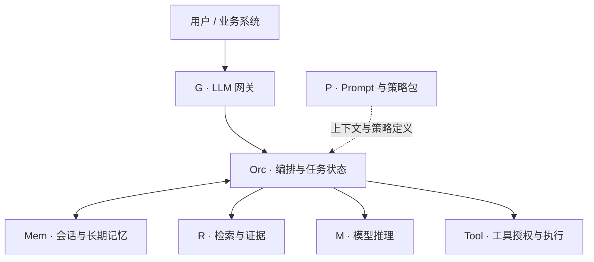
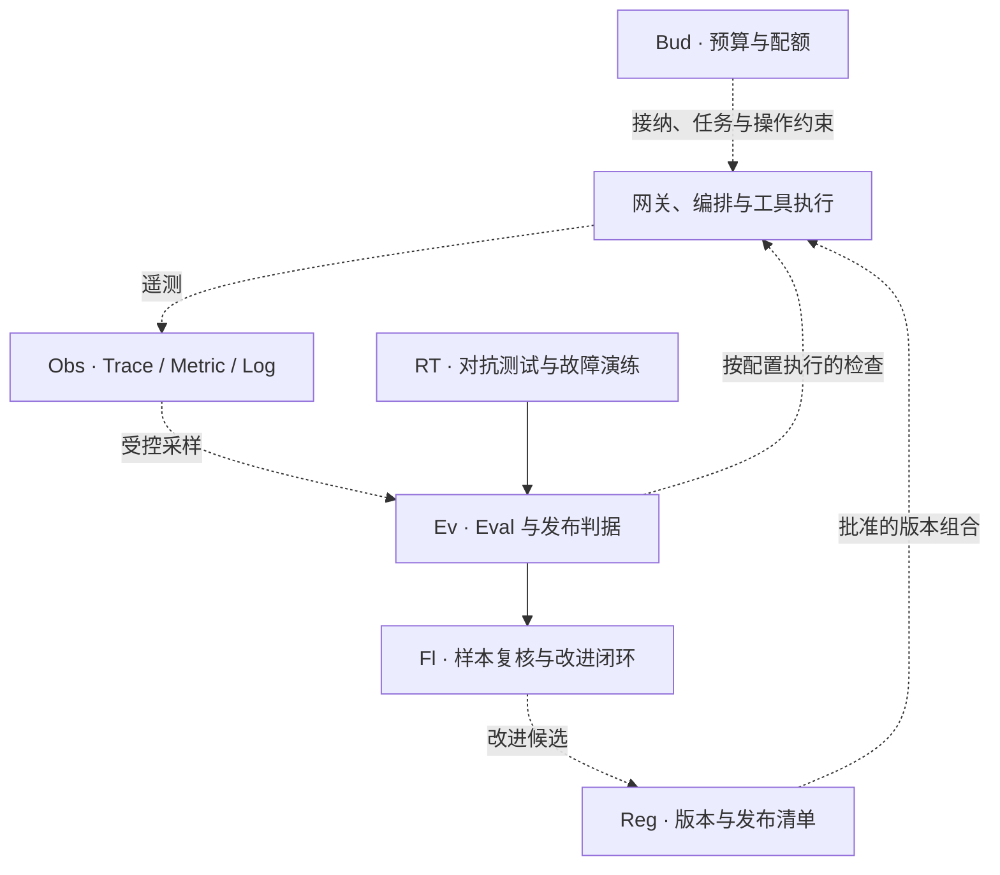

# 第 11 章 · AI 系统参考架构

> 所属：第三部分 · 架构决策  ·  [← 返回目录](../README.md)

把事故助手画成"用户 → 模型 → 工具"，能说明它如何工作，却不足以说明它如何在生产中运行：权限在哪里检查，检索能看到哪些数据，质量退化由谁发现，一次发布包含哪些版本，停止任务后已经发出的重启又由谁确认？

第二部分分别建立了这些能力。从本章开始，将它们汇成可评审的架构、责任与决策记录。参考架构首先是一张检查边界的地图；图上的方框不必分别实现成服务，但承担的责任需要有落点。

---

## 1 · 用参考架构检查遗漏，而非规定产品形态

评审架构图时，沿一个正常请求和一个失败请求走完流程：它们读写什么状态，经过哪些授权与质量检查，在哪等待或重试，失败后由谁接手。随后再看发布、监控、预算和恢复如何影响这两条路径。

图可以合并组件，也可以省去不需要的能力。一个只做文本分类的服务，未必需要 RAG 或长期记忆；一个只接单家模型的应用，也可能需要统一鉴权和配额。是否拆独立网关，取决于接入、复用与运行需求，不能仅由供应商数量决定。

下面的四个面是本书组织职责的视角，不是行业统一标准，也不是必须照搬的组织边界。同一组件可以承担多种职责：记忆既参与上下文构造，也存储业务数据；在线 verifier 也可能直接参与请求路径。评审需要把这些实际关系画出来，而非根据方框被放在哪一面判定设计对错。

---

## 2 · 端到端参考架构图

下面两图配合阅读：第一张画主要请求与上下文关系，第二张画运行证据、质量与发布控制。它们是同一套职责的两个视角。

实线表示主要请求或工作流关系，虚线表示配置、控制和证据关系。图省略了部分返回与观测连线，不能用它替代完整的数据流和信任边界图。

四个面分别提醒我们检查：谁能接入、依据什么指令和状态；任务如何检索、推理与执行；结果如何验证并推动改进；运行时如何观察、限额和恢复。P 中的策略文本需要在相应执行端落实，不能仅靠注入 prompt 获得强制力。

离线评估和在线校验应分别标注。在线 judge 故障时如何处理，取决于它承担的任务和风险；离线评估不可用，则主要影响发布和调查能力。Obs、Reg 或 Bud 故障，也应按缓存、可用记录和预设策略决定影响范围，不能一律推导为全站不可用。

---

## 3 · 七组件契约表

每个组件保留五栏：**职责、SLO、失败模式、归属、可替换边界**。填写时，职责应说明输入、输出和状态；SLO 应说明对象、分母、测量点与目标；失败模式要连接到处置；归属应能找到实际维护者；替换边界应说明什么保持兼容、什么需要迁移与复验。

不是所有要求都适合放进误差预算。"越权动作不得执行"是授权约束，不能解释为允许一定比例的违规；评估它需要反例测试、审计和控制验证。下表中的目标维度也不是全书默认数值，具体目标由业务与实测确定。

### G · LLM 网关

| 栏位 | 契约要点 |
|---|---|
| 职责 | 验证接入身份，执行接纳、配额与路由，保留流式和错误语义 |
| SLO | 网关增加的延迟、完整转发率；归因指标与用户端结果关联 |
| 失败模式 | 排队无界、重试放大、流式缓冲或中断；明确拒绝与取消行为 |
| 归属 | 网关维护者负责组件；服务负责人负责用户承诺 |
| 可替换边界 | 协议适配保留模型能力差异，客户端有版本与兼容测试 |

### P · Prompt 与 Policy

| 栏位 | 契约要点 |
|---|---|
| 职责 | 管理模板、变量和策略定义，以可追溯版本构造上下文 |
| SLO | 渲染成功率、版本可追溯性、经演练验证的回滚时间 |
| 失败模式 | 缺失变量、错误环境、版本未传播；阻止无效配置发布 |
| 归属 | 应用负责人维护任务语义，平台维护发布与版本机制 |
| 可替换边界 | 模板与代码的输入契约可测试，模型迁移后重新评估行为 |

Prompt 回滚只能撤回后续请求使用的配置，不能撤销既有输出或外部动作。实现与演练见[深入 21](../深入/21-Prompt作为运维对象.md)。

### Orc · 编排器

| 栏位 | 契约要点 |
|---|---|
| 职责 | 调度任务、管理状态、落实全局预算，协调校验与恢复 |
| SLO | 约定负载内的任务完成与恢复时效；显式报告停止和未知状态 |
| 失败模式 | 循环、重复调度、检查点丢失；限制预算并确认在途动作 |
| 归属 | 应用或工作流维护者，协同平台与 SRE 维护运行控制 |
| 可替换边界 | 状态、任务标识和操作协议可迁移，恢复语义保持一致 |

Harness 的授权、状态、预算与审计职责横跨 Orc、Tool、Mem 和 Obs。可以用库、服务和基础设施共同实现，但每条关键约束都要说明强制执行的位置，不能只在图上画一个名为 Harness 的方框。多 Agent 的交接与恢复见[第 7 章](../知识/从链到图-多智能体系统的可靠性.md)。

### M · 模型推理

| 栏位 | 契约要点 |
|---|---|
| 职责 | 在已说明的输入、生成配置和能力范围内提供推理 |
| SLO | TTFT、生成停顿、完整交付与分桶质量；标明入口边界 |
| 失败模式 | 限流、截断、错误路由、质量回归；验证降级与停止条件 |
| 归属 | 内部接入或推理服务负责人；供应商只承担合同内的部分 |
| 可替换边界 | 协议兼容之外，还需验证质量、工具行为、容量与数据条件 |

更换模型不应要求无关权限控制一起重写，但也不能承诺它像替换一个完全等价的函数。模型行为需要按实际任务重新验收。

### R · 检索（RAG）

| 栏位 | 契约要点 |
|---|---|
| 职责 | 按授权范围返回适用证据，包含来源、版本与时间信息 |
| SLO | 在注明样本和标注口径下测召回、适用性、时效与延迟 |
| 失败模式 | 越权召回、过期资料、证据不足；过滤、重取或显式报告缺口 |
| 归属 | 应用与数据维护者分别认领任务要求、索引与源数据同步 |
| 可替换边界 | 原文、切块、向量、元数据和权限可导出、重建或追溯 |

### Tool · 工具执行

| 栏位 | 契约要点 |
|---|---|
| 职责 | 校验动作授权与资源状态，以受限凭证执行并返回结果 |
| SLO | 执行与确认时效；另行验证越权拒绝、操作审计等约束 |
| 失败模式 | 重复写入、审批失配、超时但已执行；通过幂等和对账恢复 |
| 归属 | 工具服务维护者与业务动作负责人，明确审批和应急权限 |
| 可替换边界 | 动作、权限、幂等和结果查询协议可测试，副作用可识别 |

### Ev · Eval 流水线

| 栏位 | 契约要点 |
|---|---|
| 职责 | 产生可追溯质量证据，支持发布、生产监控和失败调查 |
| SLO | 完成率、新鲜度、分桶覆盖；判定可信度单独校准 |
| 失败模式 | 数据缺失、标签错误、judge 漏放；标记未知并走预设策略 |
| 归属 | 评估维护者管理管线，领域负责人共同维护判定标准 |
| 可替换边界 | 样本、标签、rubric 与评估器版本可区分并受控迁移 |

其余六个组件同样要有契约：Mem 管数据访问、时效与任务隔离；Fl 管样本复核到验证的闭环；RT 管攻击与故障场景；Obs 管采集完整性与数据权限；Reg 管发布清单、制品与历史可用性；Bud 管接纳、配额预留和超限行为。无需为了补齐名字各建一个新平台。

---

## 4 · S / M / L 三档参考实现

为延续全书简称，保留三种部署形态。它们描述控制与运行方式，不是成熟度、团队规模或采购等级，也不是必经的升级顺序。

| 形态 | 典型组合 | 引入的责任 | 适用判断 |
|---|---|---|---|
| S：单一接入 | 一个主要模型路径，控制可内置于应用 | 任务评估、权限、预算与恢复仍需具备 | 单一路径能满足业务与数据条件 |
| M：共享或多上游接入 | 共享网关、路由、版本与评估能力 | 协议差异、共享故障域、切换与租户隔离 | 复用或替代路径的收益可验证 |
| L：包含自管推理 | 自管、托管或外部 API 按任务组合 | 容量、设备、执行栈、升级与值班 | 某类负载存在可论证的自管需求 |

S/M/L 不按统一美元区间标定，也不绑定人数或工期。预算应使用自己的任务量、单价、负载和总成本测算；后文使用这些简称时，只表示本节部署形态，不能从字母推回财务规模。

### S · 最小可运行控制

Prompt 和配置可以存于 Git，编排与授权控制可以内置在应用，评估可以由受控样本和发布检查起步。没有检索或工具时，相应组件可省去；接入后就要补齐权限、证据与副作用契约。小系统同样需要识别发布版本、超时、重试和成本上限，月末告警无法代替任务内预算保护。

### M · 共享接入与经过验证的替代路径

当多个应用重复建设接入控制，或者业务需要替代上游时，可以引入共享服务。先明确服务边界、容量隔离、路由依据和失败降级，再决定是否独立部署。

有两个上游不等于有两条可用业务路径。备用模型还需要可用配额、适用的数据条件、兼容的工具与输出、任务质量和切换演练；两个上游也可能共享云、网络或控制面。不能仅凭供应商 SLA 或数量推导端到端可用性。

### L · 按负载引入自管推理

自管可以从一个受控任务或专用模型开始，无需同步引入微调、跨区域和研究型评估。它的必要性来自实际约束与收益，而不是账单超过某个通用数字。

上线前验证代表性负载、质量、容量余量、构建与版本恢复、设备故障和团队升级路径。团队可以依靠成熟服务框架与支持体系，并不要求每位维护者会写 CUDA；但遇到相应层级的问题时，需要有可用的诊断与响应能力。经济比较还应计入利用率、冗余、人员、迁移和退出成本。

> [!WARNING]
> **何时重审部署形态**：业务时限、数据边界、任务质量、供给配额、稳定负载或维护能力变化时，重新比较方案。可以只让某个任务改走另一条路径，也可以撤掉收益不足的共享组件；换形态本身不证明能力提高。

---

## 5 · 跨形态的工程基线

无论部署形态如何，服务都要说明：

1. **结果如何验收**：及时、完整、符合任务要求的测量边界及失败处理。
2. **发布如何追溯**：用发布清单绑定实际依赖的模型、prompt、检索与数据、工具、策略和评估版本；不适用项明确标记。
3. **资源如何受限**：任务、重试、等待与外部操作有预算；取消与在途动作有处置规则。
4. **动作如何授权**：执行端校验身份、范围和前提，覆盖实际数据与外发路径。
5. **失败如何恢复**：保留可用版本、状态与证据，明确回滚、补偿和结果未知的处理。

基线要由相应测试和演练证明。四联版本只是常见起点，不是永远完整的发布单元；没有 embedding 的任务不必编造一个版本，有索引和工具变化的任务也不能只绑定四个名字。

---

## 6 · 演进路径与高退出成本

改变部署形态，可能逐步增加数据、协议和组织耦合，但并非每次切换都不可逆。六类常见成本值得在决定前检查：

| 决策对象 | 主要退出成本 | 可以保留的选择 |
|---|---|---|
| Embedding 与检索存储 | 重算向量、重建索引、权限与检索语义复验 | 保留源数据与版本，隔离新旧索引并验证切换 |
| 网关协议 | 客户端兼容、能力映射与错误语义 | 版本化契约与真实客户端回归 |
| 自管推理 | 设备、人员、供给与运行模式变化 | 按任务保留替代路径并核验激活条件 |
| 微调 | 数据、基座、训练与回归依赖 | 比较其他适配方法，保留数据与实验记录 |
| 评估资产 | 重新标注、历史可比性与标准迁移 | 标签与 rubric 版本化，保留桥接样本 |
| Prompt 与业务耦合 | 语言行为与业务决策难以分离 | 将强制业务规则落实在可测试的执行端 |

更换 embedding 常需按新模型重新处理相关语料，但可以采用新旧索引并行构建与分批切换；仅更换存储也可能因过滤、排序和索引能力不同而代价很高。不存在由技术名称直接决定的统一迁移月数。第 15 章将把这些差异转成迁移、运行和退出计划。

---

## 7 · 把图变成一次可复核的评审

对事故助手，至少走三条路径：一次正常分析、一次错误证据进入上下文、一次写操作响应丢失。逐条指出授权、质量、预算、状态、责任和恢复落点。

最后留下当前架构与边界图、实际组件契约、一个批准的发布组合，以及下一项演进的证据与退出条件。评审据此判断当前承诺是否可运行；不能用组件齐全替代端到端验证。

---

## 接下来

- **下一章**：[第 12 章 · AI SRE 组织设计](02-AI-SRE组织设计.md) —— 给组件和协作边界配置可执行的责任
- **配套决策**：[第 13 章](03-架构师的决策框架.md) · [第 14 章](04-AI-SRE成熟度模型.md) · [第 15 章](05-不可逆决策与Day2状态.md)
- **专题**：[模型注册与发布](../深入/15-模型注册表与上线流程.md) · [Embedding 服务](../深入/16-Embedding-服务作为独立运维对象.md) · [LLM 网关](../深入/17-LLM网关的SRE视角.md)

复习：[核心概念卡](../复习/核心概念卡.md) · [Active Recall 题库](../复习/Active-Recall题库.md)

---

← [第 10 章](../知识/09-工程底座.md)  ·  [📖 目录](../README.md)  ·  [第 12 章 →](02-AI-SRE组织设计.md)
