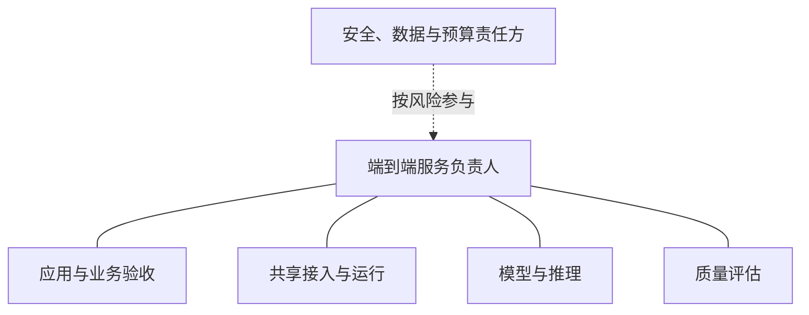

# 第 12 章 · AI SRE 组织设计

> 所属：第三部分 · 架构决策  ·  [← 返回目录](../README.md)

事故助手开始给出不适用的恢复建议。应用团队负责 prompt，平台负责网关，ML 团队负责模型接入，评估管线由另一组人维护。每个组件都有 owner，但没人知道谁能暂停发布、谁确认业务影响，以及哪个团队应先修复跨区域检索。

第 11 章让技术责任有落点。本章补上组织契约：谁对服务结果负责，谁执行具体工作，谁有权作决定，以及团队之间如何请求和获得支持。把这些关系写成可运行的机制，比增加一个团队名称更有用。

---

## 1 · 服务负责人需要实际的协调与停止能力

每项用户服务应有明确的端到端负责人及维护团队。它可以在应用、产品或平台团队，不必固定由入口网关团队承担。负责人需要理解任务承诺，协调依赖方，并能通过约定流程获得修复、停止或降级所需的支持。

这种能力不等于无条件支配所有团队的排期。至少应约定：事故如何升级，谁担任 IC，什么情况下暂停发布或自动动作，跨团队高风险缺口由谁决定优先级。常态工作则需要明确的需求入口、响应预期和资源协商机制。

如果负责人只有责任，却没有所需权限、值班覆盖或维护时间，组织图并没有解决问题。[NIST AI RMF Playbook 的治理建议](https://airc.nist.gov/airmf-resources/playbook/govern/)同样强调角色、责任和沟通链路需要清楚，并落实到实际流程。本章以下模式是职责安排示例，不是该框架规定的组织结构。

---

## 2 · 三种职责安排，按协作需求选择

"团队"在这里指职责单元，可以由同一组织兼任，也可以拆为不同部门。公司总人数、推理账单和业务线数量可以提示负担变化，但不足以单独决定架构或汇报关系。

| 模式 | 工作怎样分配 | 适用线索 | 要防止什么 |
|---|---|---|---|
| A · 一体式 | 应用与运行人员共同维护一个服务 | 场景集中、依赖少、协作成本低 | 关键人单点、评估无人复核 |
| B · 共享平台协作 | 应用使用共享接入、推理和评估能力 | 重复建设增加、跨团队支持需求稳定 | 平台与应用之间的质量责任空缺 |
| C · 联邦或矩阵协作 | 多产品团队与专业平台、风险职能协作 | 多区域、复杂供给或专业审查需求 | 决策多头、职责重叠与升级缓慢 |

### 模式 A · 一体式

同一团队可以写 prompt、接模型、做评估和参与值班。仍要把发布、复核和应急角色区分清楚，指定维护时间、备份人员及超出能力时的支持路径。高风险变更可以引入另一位合格评审者或外部专业支持，不必先成立完整评估部门。

### 模式 B · 共享平台协作

常见的三个专业方向是接入与运行、模型与推理、质量评估。应用团队提供任务语义和业务验收，并继续承担相应服务责任；不能把它留在组织图外，等出问题时再找它解释正确答案。

这些方向需要共享任务与版本记录、变更预告、质量和容量证据，以及明确的响应接口。可以通过例会、异步审阅和自动化门禁实现，是否开三个固定周会并不是有效性的判据。

### 模式 C · 联邦或矩阵协作

当不同产品需要不同发布节奏、专业支持或数据边界时，可以分设基础设施、平台、应用与风险职能。每条服务链仍需明确决策范围，避免"平台批准技术上线、产品批准业务上线，但没人知道两者是否都完成"。

增加层级前，先确认新职责能解决实际瓶颈，并说明它与现有团队的交付边界。小型专业服务也可能需要复杂审查，大型组织也可以为单个低风险应用保持简单安排。

---

## 3 · RACI：按决定的范围区分执行与负责

**R（Responsible）**执行工作，**A（Accountable）**对这项工作的结果或决定最终负责，**C（Consulted）**在作决定前提供必要意见，**I（Informed）**接收结果信息。

一项范围清楚的工作通常指定一个 A，可以有多个 R，但需明确执行协调人。R 和 A 可以由同一角色承担，也可以分开；需要独立复核时，不应为了填表方便强行合并。若一行同时涉及技术发布、数据例外和合同批准，应拆成不同决定，而不是让多个 A 争夺同一范围。

下面是按工作列角色的示例，具体岗位名称由组织填写：

| 工作或决定 | A：结果负责人 | R：执行者 | C：必要协商 | I：需知情者 |
|---|---|---|---|---|
| 任务验收与服务 SLO | 应用服务负责人 | 应用与评估维护者 | 业务、平台、SRE | 值班人员 |
| 推理部署与资源承诺 | 获授权的技术预算负责人 | 推理与平台工程师 | 应用、评估、预算方 | 服务维护者 |
| 工具授权范围 | 对应权限责任人 | 工具服务维护者 | 安全、数据、应用 | 值班与审计方 |
| 评估标准与标签版本 | 任务质量负责人 | 领域评审与评估人员 | 应用、ML、风险方 | 发布人员 |
| 具体版本发布放行 | 获授权的发布负责人 | 发布执行与验证人员 | 业务、SRE及风险方 | 依赖团队 |
| 评估管线运行 | 评估服务负责人 | 管线维护人员 | 平台、SRE | 发布与应用团队 |
| 端到端事故处置 | 当次指定 IC | 相关服务响应者 | 安全与业务负责人 | 沟通对象 |
| 数据处理要求与例外 | 获授权的数据责任人 | 数据与平台维护者 | 安全、隐私及法务 | 使用方 |
| 对外披露或合同批准 | 相应获授权负责人 | 对应专业与业务人员 | 技术、安全等相关方 | 受影响团队 |

这张表本身不授予权限，也不替代内部正式授权。需要多方批准的事项，应在发布流程中分别检查各项决定；用一个"A"不能取消这些要求。

### 让具名批准可追溯，也能交接

对于影响大或难恢复的决定，应在记录中留下实际批准者、授权范围、证据、接受的风险和失效条件。批准者需要理解关键风险或取得合格专业评审，不能只看一页摘要签字；但也无需亲自运行每一项测试。

还要有替补与升级机制。把所有批准绑定到一位无法替代的人，会形成新的运行瓶颈。拒绝、例外与推翻决定都应有清楚的权限和留痕流程，而非假定某个人的意见永远不可更改。

---

## 4 · 独立评估依靠什么成立

独立性要解决的是利益冲突：当发布方有动力提高得分、缩小失败定义或忽略风险时，是否有人能检查并阻止这些行为。

独立汇报线是一种实现，但并非唯一方法，也不能单凭汇报关系证明评估有效。可以组合使用独立评审者、受保护的验证样本、标签与标准变更审查、明确的停止权限、风险例外记录，以及直接升级到有权决策者的渠道。

领域和 ML 人员可以参与 rubric 与 gold set 的建设，他们往往掌握必要知识。关键是不能在看到发布成绩后，未经审查修改判定标准再宣布通过；开发样本、回归集与独立验证样本也要按用途管理。

风险越高，评审独立性、证据保留和挑战权限就越需要明确。选择独立小组、嵌入式安全人员还是跨团队评审，应检查其专业能力、投入、访问条件和实际阻断效果，不能用人数或部门名称代替验证。

---

## 5 · 接口契约比会议信息更能支撑协作

每项跨团队服务应写明提供什么、对谁承诺、需要上游什么输入，以及故障和变更如何处理。下面几条边界尤其容易遗漏：

| 接口 | 提供方应交付什么 | 使用方应补充什么 |
|---|---|---|
| 应用 ↔ 评估 | 可追溯结果、分歧与覆盖缺口 | 任务要求、样本语境、业务损失 |
| 应用 ↔ 网关 | 协议、接纳和路由语义 | 负载预测、取消需求、允许的降级 |
| 网关 ↔ 推理 | 实际负载与入口观测 | 容量边界、模型配置和变更影响 |
| 工具 ↔ 权限责任方 | 资源范围、动作审计与结果查询 | 业务授权、审批与应急规则 |
| 发布 ↔ 值班 | 版本组合、验证证据和恢复入口 | 可接管能力、告警与演练反馈 |

例如，评估团队若只承诺"每天出分"，应用团队却把结果用于即时发布，接口就不匹配。双方要约定结果新鲜度、未完成状态和超时后的处置，不能在发布当天临时找人补判。

同理，通用平台、MLOps 和 AI 平台之间没有固定的行业归属公式。已有团队可以承担网关、Registry 或实验基础设施，只要能力和责任契约覆盖实际需求。不要因组件带上 AI 名称，就重新复制一套平台。

---

## 6 · 用协作故障决定如何调整组织

识别组织问题时，优先看可观察的行为：跨团队缺口长期无人处理，事故升级找不到人，评估标准随上线压力变化，值班人员没有停止权限，关键变更始终依赖同一个人。这些都比公司人数更能说明职责安排需要调整。

先确定瓶颈属于哪一类：缺维护容量，就安排时间与备份；缺专业能力，就补训练或支持；决定权冲突，就划清范围与升级路径；重复建设成本高，再考虑共享平台。拆团队未必能解决前两类问题。

组织交接与系统迁移可以同时发生，但会增加协调负担。若确需并行，应明确各阶段的指挥、在途任务、版本和回退责任，并限制一次变更的影响范围。是否继续推进，应由交接验收与演练决定，无需机械等待半年。

---

## 7 · 用一次演练验收责任设计

回放开头的事故：质量管线没有抽到受影响区域，应用想继续发布，工具已有动作在途。让相关人员实际确认：谁能暂停扩流，谁补样本，谁查询动作状态，谁判断恢复完成，下一班如何接手。

记录每个请求卡在哪个接口、等待多久、有没有临时借用个人关系。若只有组织图上的负责人能解释流程，其他执行者无法独立接手，就继续补充权限、文档和演练。

本章应留下具名服务责任、范围清楚的 RACI、跨团队交付契约、停止与升级规则，以及验证这些机制可用的记录。下一章将用它们支持具体架构选择。

---

## 接下来

- **下一章**：[第 13 章 · 架构师的决策框架](03-架构师的决策框架.md) —— 将分歧转为条件、证据与可执行选项
- **配套**：[第 9 章 · 组织与判断力](../知识/08-组织与判断力.md) · [附录 E · 模板库](../附录/E-模板库.md)
- **诊断参考**：[深入 11 · AI SRE 现实图谱](../深入/11-AI-SRE现实图谱.md)

复习：[核心概念卡](../复习/核心概念卡.md) · [Active Recall 题库](../复习/Active-Recall题库.md)

---

← [第 11 章](01-AI系统参考架构.md)  ·  [📖 目录](../README.md)  ·  [第 13 章 →](03-架构师的决策框架.md)
