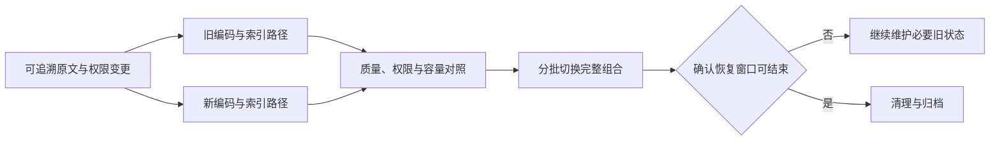

# 第 15 章 · 不可逆决策与 Day 2 状态

> 所属：第三部分 · 架构决策  ·  [← 返回目录](../README.md)

团队决定更换事故助手的 embedding 模型。新模型在离线任务上表现更好，查询代码也已改完，迁移似乎只剩切流量。上线前才发现：旧索引无法继续接收更新，权限元数据没有完整导出，新索引构建需要占用生产资源；如果质量回归，切回旧地址也拿不到最新证据。

第 13 章帮助选择方案，第 14 章检查当前控制。本章关心选择随时间积累的后果：上线以后谁维护什么状态，哪些条件使恢复成立，未来改变方向需要付出什么。所谓"不可逆"，在工程讨论中往往实际指退出成本高、后果难以撤回或退路尚未验证，应分别说清。

---

## 1 · 区分回滚、迁移与撤销后果

**回滚**通常让后续请求回到已知版本或配置。**迁移**把数据、客户端或运行责任转到另一套实现。**撤销或补偿**处理已经发生的外部后果。三者不是同一动作，也没有通用时间带。

改 prompt 的配置可能很快回滚，但它已经发出的工单或泄露的数据不会随之消失。更换向量库可能需要较长准备，却能通过兼容接口和并行索引保留切换能力。不能按技术名称直接判断哪个决定"完全可逆"。

可以用五类情形分析成本；它们会重叠，不是从轻到重的统一等级：

| 情形 | 主要问题 | 评审重点 |
|---|---|---|
| 局部配置可撤回 | 旧版本能否生效，既有副作用是否可处理 | 传播、状态与暴露范围 |
| 需要状态迁移 | 数据、格式或索引已改变 | 同步、兼容和切换窗口 |
| 跨系统高成本耦合 | 多客户端、供给与运行模式一起改变 | 分阶段实施、协调与支持能力 |
| 外部承诺受限 | 合同、数据处理或客户承诺影响选择 | 获授权责任方确认允许的变更与退出 |
| 组织路径依赖 | 知识、排期与激励集中于既有方案 | 未来成本、替代能力和决策机制 |

合同和组织依赖不一定永远无法改变，但工程上的可替换不能自动取消外部承诺。历史投入也不应成为继续维护的唯一理由；应比较未来收益、退出成本和人员安排。

---

## 2 · 八类值得检查的高退出成本选择

承接第 11 章，再把外部承诺与内部平台纳入检查。表中不规定统一工期，因为数据量、权限、兼容与组织依赖才决定实际工作。

| 选择 | 可能留下的耦合 | 退出能力如何验证 |
|---|---|---|
| Embedding 与检索存储 | 向量空间、切块、过滤与排序 | 源数据可重建，新旧检索组合可对照和切换 |
| 网关协议 | 客户端依赖流式、错误和工具语义 | 真实客户端的兼容测试与版本迁移 |
| 自管推理 | 设备、容量、人员与响应路径 | 替代路径满足质量、容量和数据条件 |
| 微调或专用模型 | 基座、训练数据与任务行为 | 数据可用，候选方案通过任务回归 |
| Gold set 与 rubric | 标签含义、历史对比与判定流程 | 版本化标准，桥接样本与分歧复核 |
| Prompt 与业务规则 | 语言行为承担强制业务决策 | 规则可独立测试，授权移到可信执行端 |
| 供应商与客户承诺 | 用量承诺、数据边界、退役条件 | 明确变更、终止与通知流程的授权责任 |
| 内部平台长期维护 | 知识、使用方与维护资源 | 依赖清单、交接与退役迁移试验 |

向量和原文可导出，不意味着检索结果等价；有备用模型账号，不意味着备用容量和行为已经可用。评审需要取得相应证据，而非只写"理论上可以换"。

### 高退出成本选择的事前四问

1. **如何退出或降级？** 逐步列出状态、依赖、执行者、时间与成本估计，区分准备时间和真正切换时间。
2. **哪些假设可能失效？** 覆盖质量、负载、供给、单价、数据和维护能力，检查失效后损失及缓解。
3. **什么事件触发重审？** 指明观测位置、触发依据、负责人和决定期限，不只写"以后再看"。
4. **上线后怎样长期运行？** 说明维护、升级、值班、数据生命周期与退役责任，并检验增长或人员变化的情境。

有未知项并不意味着所有决定都要停下。可以先限制任务和流量，做不扩大不可恢复损失的实验；当证据不足以支持当前风险时，才暂停相应放行。评审深度由后果和未知决定，而非作者职级。

---

## 3 · 一个具体迁移：同时保留旧检索的恢复能力

更换 embedding 通常需要用新模型处理相关语料，并为查询使用匹配的编码与索引配置。它可以分阶段实施，不必先删除旧索引再一次性重建。

开头的事故助手可以采用以下过程：

1. **冻结基线定义**：记录原文版本、切块、embedding、索引配置、过滤与权限规则，保存代表性查询和任务判定。
2. **构建独立新索引**：从可追溯数据回填，限制构建资源；同时处理期间的新增、更新与删除，防止新旧状态分叉。
3. **对照完整检索路径**：新旧查询各使用匹配的 embedding 与索引，检查召回、适用性、越权、过期资料、延迟和任务结果。
4. **分批切换并观察**：按明确任务或租户切换完整组合，记录所用版本；满足停止条件时回到仍可运行的旧组合。
5. **确认后再收缩旧路径**：依据业务与恢复需求决定何时停止同步和删除旧资产，保留必要记录与清理证据。

图中的双路径是一项需要实现和验证的同步契约，不是画两条箭头就获得一致性。删除传播、权限撤销、重复更新和重建期间的变化，都要进入测试。旧索引若已过期，恢复按钮只是把请求送回另一种错误状态。

[AWS 的蓝绿部署资料](https://docs.aws.amazon.com/whitepapers/latest/blue-green-deployments/best-practices-for-managing-data-synchronization-and-schema-changes.html)讨论了相同的基本约束：回到旧环境要求它仍能处理当前数据，破坏兼容的状态变更会缩小回退能力。检索迁移也应验证自己的状态和接口条件，不能直接套用数据库做法便宣称安全。

---

## 4 · Day 0 / Day 1 / Day 2 / Day N

这里用几个阶段提醒评审覆盖生命周期，不把它们绑定为固定年份或精力百分比。

| 阶段 | 要解决的问题 | 需要留下什么 |
|---|---|---|
| Day 0 · 设计与准备 | 承诺、边界和未知是否说清 | 契约、决策与验证计划 |
| Day 1 · 上线与迁移 | 新旧路径怎样共存、切换与停止 | 版本、流量、状态与放行记录 |
| Day 2 · 持续运行 | 变更、增长和故障怎样被处理 | 维护责任、质量证据和恢复能力 |
| Day N · 演进或退出 | 原假设改变后还能否调整 | 场景分析、依赖替换与退役计划 |

上线并不天然是最低风险阶段；未知行为、迁移状态和首次承载真实任务都可能集中暴露。设计也无法提前消除大部分未来问题。运行证据必须持续反馈到设计，不能把上线后只留给"维护人员"。

Day 2 至少应有人维护版本清单、源数据与索引同步、评估标准、配额与容量、凭证和审批、专业升级路径。新增业务、模型或工具时，回到契约检查影响；原来的恢复时间和任务质量不应自动沿用。

---

## 5 · Day N 状态图应表达情境与选择

长期图不是要求预测三年后每个团队的名字，而是检验今天的决定在不同条件下是否仍可维持。可以选增长、供给变化、人员流失和数据要求变化几个情境，画出三个方面：

- **责任与支持**：如果当前维护者离开，哪些职责需要交接，谁有权限和能力接管，专业支持是否仍可获得。
- **成本与资源**：任务量、单价、利用率、冗余和维护工作改变后，哪些成本成为主要约束；注明估计和不确定性。
- **替代与退出**：候选路径需要哪些数据、配额、协议、人员与批准，准备时间、切换时间和可接受降级分别是什么。

例如，外部 API 路径因数据条件变化不能再使用时，"退回 SaaS"就不是有效退路；自管容量不足时，只有模型权重也无法承接流量。图应明确这些激活条件，并区分已验证、部分验证和设想中的选项。

退路需要资源，保留所有路径也可能不划算。可以维持热备、定期验证的冷路径，或明确接受一段迁移停机；哪种合适，取决于业务损失和维护成本。关键是把选择写明，并在相关假设改变时重审。

---

## 6 · 用演练维护退出能力

退路演练的周期由变化速度、风险和业务承诺决定，不是统一每年一次。模型退役、索引结构变更、凭证调整或关键人员交接后，至少重验受影响部分。

演练可以分级：先检查制品、权限与资源是否存在，再用代表性任务回放和容量验证，必要时做受控流量切换。分别记录质量、准备时间、恢复时间、未确认副作用和数据一致性；未覆盖的部分明确保留为未知。

若过去估计的切换时间已经超出业务容忍度，应比较修复退路、调整服务承诺、提前迁移或接受风险的代价。不能仅因一份旧计划失效就要求立刻退出，也不能继续在对外承诺中引用未经验证的数字。

大变更可以分段时，优先减少同时变化的因素，便于归因和恢复；确有依赖关系需要联动时，应把它们作为完整发布组合验证。不存在所有高退出成本决策都必须间隔三个月的通用规律。

---

## 7 · 模型废弃与平台退役

收到上游退役通知时，实际剩余期限可能很短，不应假定总有六个月准备。先列受影响的模型版本、任务、prompt、工具能力、配额、数据处理与外部承诺，再评估替代方案和迁移窗口。

迁移按任务对照、灰度和停止条件推进。若旧模型即将停止服务，就不能把回滚到它当作长期保障；需要确认备用能力、降级交付或暂时停止相应功能。清理阶段还应处理路由、调用方、凭证、缓存和保留数据，而不是只把配置里的模型名替换掉。

内部平台退役同样需要依赖清单、明确接替或终止方式、使用方验收和清理记录。通知期取决于依赖、风险及约定；严重安全问题可能要求先停止，再组织迁移。人员能力和后续职责也要安排，避免把技术退役变成个人贡献的否定。

---

## 8 · 本章的评审产出

留下四份相互关联的记录：高退出成本与副作用清单，事前四问及未决假设，Day 2 运行与 Day N 情境图，以及退路或退役演练计划。每份记录注明范围、负责人、验证状态与重审事件。

这让第 13 章的"选什么"与第 14 章的"能否控制"继续延伸到"以后还能怎样改变"。下一章将检查其中的资源和经济条件：这些运行与退出承诺，是否有相应预算支撑。

---

## 接下来

- **下一章**：[第 16 章 · 预算治理](06-预算治理.md) —— 为运行、风险与退出保留真实资源
- **配套**：[第 17 章 · 与外部世界的契约](07-与外部世界的契约.md) —— 对齐外部承诺与实际迁移能力
- **专题**：[Embedding 服务](../深入/16-Embedding-服务作为独立运维对象.md) · [Prompt 运维](../深入/21-Prompt作为运维对象.md)

复习：[核心概念卡](../复习/核心概念卡.md) · [Active Recall 题库](../复习/Active-Recall题库.md)

---

← [第 14 章](04-AI-SRE成熟度模型.md)  ·  [📖 目录](../README.md)  ·  [第 16 章 →](06-预算治理.md)
