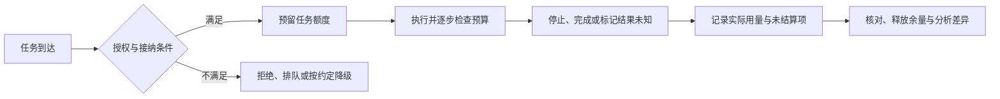

# 第 16 章 · 预算治理：四种 budget 的统合视图

> 所属：第三部分 · 架构决策  ·  [← 返回目录](../README.md)

事故助手为了降低费用换了小模型，错误建议增加，团队又加了两轮校验和重试。单次模型调用更便宜，完整任务却可能更慢、更贵；若新的校验还放过关键错误，这项优化甚至没有换来原本期望的质量。

第 15 章要求运行与退出承诺有资源支撑。本章把支出、容量、风险敞口和服务误差摆到同一份决策里。它们互相影响，但单位和约束性质不同，不能相加成一个健康分，也不能用其中的富余抵消另一项硬约束。

---

## 1 · 四类预算，先说明各自能约束什么

本书沿用 Token、GPU、Risk、Error 四个简称。它们是讨论视角，不是对传统 SRE 或 FinOps 工作的完整分类。[FinOps Framework](https://www.finops.org/framework/)强调工程、财务和业务协作，以使用与成本证据支持技术价值判断；本章将这一协作延伸到任务可靠性与运行控制。

| 简称 | 实际管理对象 | 不能混淆的区别 |
|---|---|---|
| Token budget | 用量与支出 | token 数不等于总费用，不同模型和计费项不能直接相加估价 |
| GPU budget | 容量与供给 | GPU-hours、显存、带宽、并发与供应商配额有不同单位 |
| Risk budget | 已授权范围内的风险敞口与处置能力 | 不代表允许越权、泄漏或用测试积分购买安全豁免 |
| Error budget | 约定 SLO 允许的坏事件 | 依赖明确分母、窗口与判定，不等于任意质量分数 |

### 支出：从使用记录到账单

至少区分模型输入、输出与缓存，embedding、重排、judge 和工具费用，以及平台、设备、人员等相关成本。单次 trace 可以记录估算用量和费用，但最终需要与计费记录核对，注明价格版本、币种、折扣、共享成本分摊及未归因部分。

财务预算通常覆盖一段时间，任务内还需要调用、输出、循环和工具使用上限。月底才看到告警，无法阻止今天的一条失控任务。若供应商计量存在延迟，实时估算也不能自动成为精确账单上限。

### 容量：额度不等于可承诺吞吐

自管推理要分别看设备时间、KV cache、计算、互联和排队；外部服务要看实际 RPM/TPM、并发、区域与模型供给。月度 GPU-hours 有余，不代表高峰显存足够；总配额有余，也不代表某个租户或模型能够及时响应。

规划需要负载分布、接纳策略和满足 SLO 的容量测试。多个区域或上游的资源只有在任务与数据条件允许转移时，才构成可用余量。细节见[第 5 章](../知识/05-AI推理服务的可靠性工程.md)。

---

## 2 · Risk budget 不能成为可兑换的安全积分

风险管理首先区分不可违反的条件和可以经授权接受的剩余风险。身份、资源授权与适用的数据要求应落实到执行端；不能因为本月还有"风险额度"，就允许未授权读取或把数据发送给错误接收方。

在已批准的范围内，可以用具体限制控制暴露：一次最多涉及多少资源、同时允许多少操作、哪些环境能自动执行、处理未知结果需要多少人工能力。这些限制是风险控制的组成部分，不能单独证明某项动作安全。[NIST AI RMF Playbook](https://airc.nist.gov/airmf-resources/playbook/manage/)把缓解、避免、转移或接受风险作为需要记录和落实的处置选择，并要求结合相应风险容忍度与责任。

一次红队回归通过，只能支持它覆盖的控制在相应条件下有效，不能统一记为减五分，再抵消一个新写工具的风险。新增工具、资料源和自治范围也没有通用的可相加点数。

更可操作的风险记录如下：

| 要记录什么 | 事故助手的示例 |
|---|---|
| 场景与损失 | 错误环境的重启建议被自动执行 |
| 暴露与控制 | 资源范围、操作并发、执行前状态检查 |
| 验证证据 | 越界请求、过期审批与重复提交回放 |
| 剩余未知 | 某类在途失败尚未完成恢复演练 |
| 决定与责任 | 限制该动作，指定验证者、批准者与重审条件 |

可计数的操作配额仍值得管理，但应保留其业务单位，不把不同损失混成一个总分。严重缺口或违规路径需要按影响及时处理，不能等月底点数结算。

---

## 3 · Error budget：先定义好事件，再计算消耗

设一个统计窗内纳入约定范围的请求数为 $N$，SLO 好事件比例目标为 $S$，则该口径允许的坏事件数为：

$$
B_{\text{allowed}}=(1-S)N
$$

若实际坏事件数为 $B_{\text{actual}}$，该窗的预算使用比例为：

$$
U=\frac{B_{\text{actual}}}{(1-S)N}
$$

教学例子：同一统计窗有 10,000 个有效请求，目标是 99% 及时完整交付，允许 100 个坏事件；实际有 140 个，则使用比例为 140%。这里统计的是同一范围与窗口，不是用本月已发生的失败去除以下月预测请求数。预算余量为负，也不意味着服务立刻停机，应执行预先约定的处置政策。

上述比例要求 $N>0$ 且 $S<1$；零流量或 100% 目标时不能照搬该比值。分母应按约定范围处理超时、取消、拒绝和截断，不能事后移除失败来改善结果。延迟、完整交付和质量可以有不同目标；同一目标中的坏事件还要明确去重规则。质量仅来自抽样时，不能直接把样本失败数记入全量预算；需要说明抽样设计、估计和不确定性。judge 失准时应标记判定不可信并补充复核，不能随意乘一个修正系数，把真实失败打折。

[Google SRE 的错误预算政策示例](https://sre.google/workbook/error-budget-policy/)将预算与发布、可靠性投入等行动关联。自己的政策也应说明范围、触发、例外和负责人。告警需要比较相应观察窗口的坏事件速率与容忍速率，不能只等一个月结束后检查是否烧光。

---

## 4 · 联合评估一次改动，而非预设固定交换关系

同一个优化，对不同任务和负载可能产生相反效果。下面的表用于提出验证问题，不预先断定收益方向。

| 改动 | 可能牵动什么 | 要取得什么对照证据 |
|---|---|---|
| 增加上下文 | 输入费用、prefill、缓存和任务质量 | 证据利用与长输入负载下的完整任务结果 |
| 增加 verifier 或重试 | 调用量、驻留时间、误拒与漏放 | 正确完成、错误交付、停止、成本与延迟 |
| 更换便宜模型 | 单价、输出长度、修复次数与质量 | 同任务、同目标下的总成本和有效完成率 |
| 提高缓存复用 | 计费、计算和状态共享 | 命中口径、版本与租户隔离、实际收益 |
| 改为批量交付 | 调度效率、等待与交付期限 | 截止时间、失败恢复和成本 |
| 接入备用路径 | 中断恢复、数据流和维护工作 | 质量、容量、切换及共因故障演练 |

例如，verifier 降低错误放行，却增加安全停止，这可能是有价值的风险取舍，但不等于完成率提高。缩短流程也可能同时减少成本和必要证据。应依据第 4 章的结果口径，在同一任务集和代表性负载下比较，再决定是否采用。

对于跨模型、工具和重试的完整任务，成本归因要关联同一任务标识。否则，单次调用省钱、失败后反复重做的费用会被记到别处，优化报告与实际账单就会脱节。

---

## 5 · 把预算落实到接纳、执行和结算

一份预算策略至少说明：约束对象、单位、窗口、归属、信息延迟，硬上限还是软预警，以及达到条件后采取什么动作。

多个 worker 共用预算时，需要统一或可协调的额度预留，避免每个分支都按"尚有余额"开始执行。重试、取消和恢复要沿用任务与操作标识，防止重复扣减或重复释放。具体请求费用难以提前精确知道时，可以按明确的上界预留，或者承认软预算的误差并保留余量。

硬上限要在相应执行点实施。供应商延迟回报、在途调用和外部工具可能让停止之后仍有费用，因此承诺精确支出上限前，需要证明计量与执行条件足够。异常告警通常只说明需要行动，并不会自行阻止消耗。

软预算则连接到获授权的调整流程：增加额度、减少接纳、推迟低优先级工作或启用已验证的降级路径。安全与数据硬约束不能通过临时加钱绕过；错误预算耗尽也不能自动触发一个未验证的新模型。

---

## 6 · 联合视图保留原始单位与决策依据

教学场景中的一次评审可以写成下面这样。数字仅用于展示口径，不是建议阈值：

| 维度 | 当前证据 | 判断与下一步 |
|---|---|---|
| 支出 | 本窗预算 2,000 元，已结算 1,400 元，另有 100 元估算在途 | 已结算占 70%；含估算约 75%，核对未结算项 |
| 容量 | 长输出桶排队超出约定等待，月度设备时间仍有余 | 先限制相关接纳，不能用月度余量解释高峰充足 |
| 风险 | 新外发工具的接收方校验尚未验证 | 暂不开放该路径，先补授权测试 |
| 服务误差 | 99% 目标下，10,000 请求有 140 个坏事件 | 本窗预算使用 140%，执行既定修复与发布政策 |

这张表不能平均成一个通过率。支出未超额，不能证明工具可以放行；修复质量也要验证对容量和费用的影响。缺失或延迟的证据应单列，不用绿色状态填补。

---

## 7 · 治理节奏跟随决策期限

快速消耗、越权路径和服务退化需要在线控制或及时响应，不能等待月会。日常核对关注计量缺失、异常和未结算项；周期评审再比较单位经济性、资源预测、风险处置和改进结果。财务规划则纳入供给承诺、维护及退出成本。

月度、季度可以作为起点，参与者按实际服务、预算与风险责任选择，不必固定五类 lead 或会议顺序。每次讨论都应产出有权限执行的决定、负责人、期限和验收证据。金额使用到 80% 不必一律告警，关键还包括窗口剩余时间、增长、信息延迟与业务后果。

> [!WARNING]
> **何时重审预算模型**：模型或工具计费、负载分布、并发结构、交付方式、权限范围或数据条件改变时，重新验证估算和控制。四类视角本身也可以扩展，不能把新增的主要约束强塞进一个失真的旧指标。

---

## 8 · 本章的产出物

交付实际单位和范围明确的预算清单、任务级接纳与结算策略、风险与剩余未知记录，以及连接到发布和恢复的联合决策视图。再用一次重试、取消或并行超额演练，证明预算在运行中有效，而非只在月报中可见。

---

## 接下来

- **下一章**：[第 17 章 · 与外部世界的契约](07-与外部世界的契约.md) —— 将内部能力与外部承诺对齐
- **配套**：[第 5 章 · 推理服务](../知识/05-AI推理服务的可靠性工程.md) · [第 8 章 · 质量观测](../知识/07-质量可观测性与DataFlywheel.md)
- **专题**：[成本工程](../深入/18-LLM成本工程.md) · [容量规划](../深入/05-LLM推理服务的容量规划.md)

复习：[核心概念卡](../复习/核心概念卡.md) · [Active Recall 题库](../复习/Active-Recall题库.md)

---

← [第 15 章](05-不可逆决策与Day2状态.md)  ·  [📖 目录](../README.md)  ·  [第 17 章 →](07-与外部世界的契约.md)
