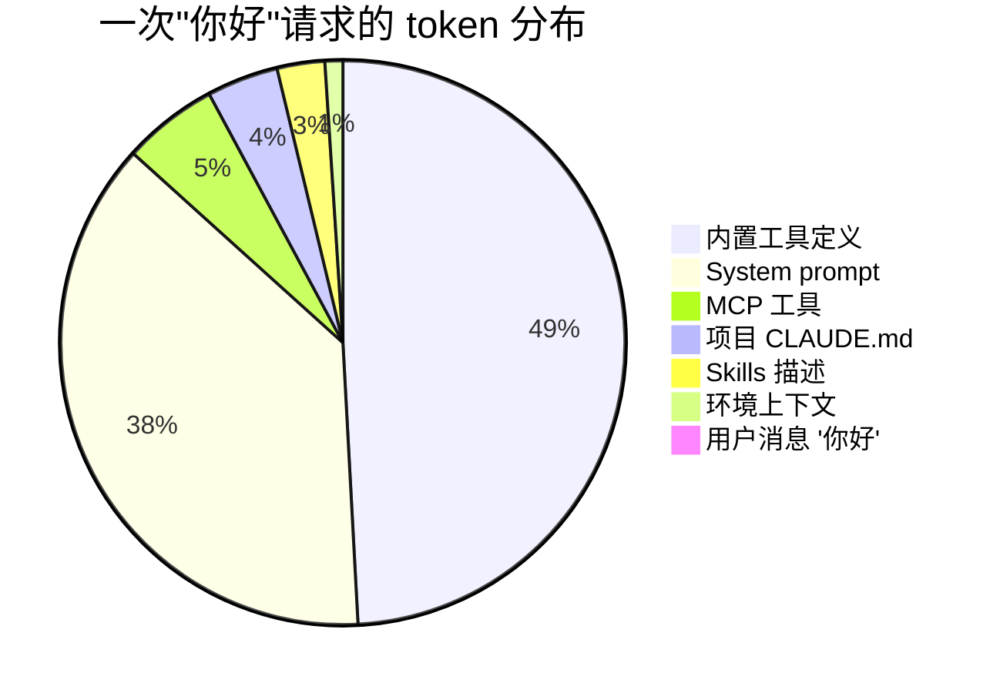

# 深入 04 · 为什么简单"你好"也会让 LLM 消耗数万 Token

> [← 返回目录](../README.md)  ·  相关：[深入 02 · Prompt Caching 原理](02-Prompt-Caching原理.md)  ·  [第 6 章 · AI 自治与上下文架构约束](../知识/06-AI自治与上下文架构约束.md)

---

## 0. 先看现象

在带有系统指令、工具定义和项目资料的编码助手中，短消息可能对应很长的模型输入。下面是本章用于解释构成的**教学估算**，不是本轮对任何客户端的实测，也不是各版本的固定开销：

| 用户输入 | 可能出现的输入量级（示意） |
|---|---|
| `你好` / `ls` | 预载较多指令和工具时，可达上万 token |
| `这个文件改一下空格` | 加载项目资料后，可能进一步增加 |
| 长对话中的一次请求 | 取决于保留历史、工具结果、压缩和检索策略 |

> [!NOTE]
> 短消息与大输入可以同时出现，但不是架构要求每个请求都达到某个 token 数。先核对实际 usage、版本和配置，再判断开销是否合理。

---

<a id="1-为什么会这样llm-api-是无状态的"></a>

<a id="1-llm-api"></a>

## 1. 为什么会这样：区分上下文与服务状态

这里需要区分**一次生成所用的上下文**与**承载会话的服务**。独立生成不会自动读到应用的所有历史；应用可以传入所需消息，也可以使用服务端会话或响应引用来延续上下文。

以 OpenAI 为例，[Conversation state 文档](https://developers.openai.com/api/docs/guides/conversation-state)提供手工管理历史、`previous_response_id` 和持久 Conversations 对象。引用 ID 可以减少客户端重传的数据，但文档明确说明：使用 `previous_response_id` 时，链中先前的输入 token 仍按输入计费。顶层 `instructions` 的延续规则也要单独核对，不能假设所有配置都会继承。

```text
客户端管理：消息 / 工具 / 所选历史 → 当前请求 → 模型可见上下文
服务端管理：新增输入 + 会话或响应 ID → 服务端组织上下文 → 模型
```

因此，应该分别问三个问题：

- **传了多少**：请求正文是全量消息，还是新增内容加引用？
- **模型看了多少**：哪些指令、历史、检索结果真正进入了本次上下文？持久存储不等于全部可见。
- **怎样付费**：未缓存输入、缓存读写、输出及工具调用分别采用什么口径？引用 ID 不等于历史免费。

一句"你好"之所以可能很贵，是客户端或服务选择带入了大量前置材料。系统角色、工具协议、项目资料和历史都可能占用输入；其中哪些必要，必须结合任务判断。

> [!NOTE]
> 本章讨论四种需要观测的影响，而不是从"无状态"推出四条普遍定律：
>
> - **缓存**：稳定前缀可能复用；命中条件与价格按模型契约核验，见[深入 02](02-Prompt-Caching原理.md)。
> - **首轮开销**：检查预载材料与延迟加载策略，不能用本章估算替代实际 usage。
> - **累计输入**：保留并反复处理完整历史时会累加，平方增长需要 §2.8 的条件。
> - **信息利用**：长窗口不保证稳定召回，需要用具体任务测试，见[科学 02](../科学/02-Lost-in-the-Middle.md)。

---

## 2. Token 构成解剖（按量级排序）

以下范围用于拆解一种预载较多材料的请求。客户端版本、工具发现和动态加载方式都会改变构成，不能据此判断当前产品的固定开销。

### 2.1 系统提示 System Prompt · 约 3k – 8k token

这是工具厂商注入的**使命书**，包含：

- **角色定义**："你是一个专业的编程助手……"
- **行为约束**：输出风格、禁忌、长度规则
- **工具使用协议**：什么时候调用什么工具、如何处理结果
- **安全指南**：哪些操作要确认、哪些禁止
- **输出格式**：markdown 规范、引用约定、代码块语言标签

本章示例可为系统指令预留数千 token；本轮未对客户端提示词做版本化测量，不据此断言其历年代际增长。

### 2.2 工具定义（Tool Schemas）· 约 5k – 15k token

每个"工具"在 prompt 里就是一段 JSON schema，给模型看它长什么样：

```json
{
  "name": "Read",
  "description": "Reads a file from the local filesystem. You can access any file directly...\n\nUsage:\n- The file_path parameter must be an absolute path, not a relative path\n- By default, it reads up to 2000 lines starting from the beginning of the file\n...",
  "input_schema": {
    "type": "object",
    "properties": {
      "file_path": {"description": "The absolute path to the file to read", "type": "string"},
      "limit": {"description": "The number of lines to read...", "type": "integer"},
      "offset": {"description": "The line number to start reading from...", "type": "integer"}
    },
    "required": ["file_path"]
  }
}
```

工具描述影响输入长度，也可能影响调用质量；增加描述能否减少误用需要测试。下面仅列估算量级：

| 工具 | 单个 token 数 |
|---|---|
| 简单工具（3-5 个参数，短描述） | 200–400 |
| 复杂工具（含示例和规则） | 800–2000 |
| Claude Code 的 `Bash`、`Edit`、`Agent` 等带详细说明的 | 1500–3000 各自 |

若预载大量工具，定义本身就可能占用数千 token；按需发现或延迟加载会改变实际输入，需检查运行版本。

### 2.3 项目上下文 `CLAUDE.md` / `AGENTS.md` · 约 2k – 10k token

工程师手动维护的项目说明——架构、依赖、命令、约定。Trae 等工具有类似的项目文件机制。

- 小项目：1-2k token
- 中等项目：3-5k token
- 复杂仓库（monorepo）：5-10k token

这部分是**可控**的。很多团队的 `CLAUDE.md` 长到上万 token 后没人管，成为成本黑洞。

### 2.4 用户级全局记忆 / 指令 · 约 500 – 5k token

- `~/.claude/CLAUDE.md`（用户全局规则）
- Memory / 持久化记忆文件
- 个人偏好（语言、输出风格）

### 2.5 MCP Servers 附带的提示 · 约 1k – 5k token

MCP 接入可能带来：

- 注册它提供的 **工具**（计入 2.2）
- 客户端额外注入的 **使用说明**（告诉模型怎么用这些工具）

是否把全部定义和说明放进每次请求，取决于客户端的工具发现与加载策略。

### 2.6 Skills / Hooks / Sub-agent 描述 · 约 500 – 3k token

Claude Code 的 Skills 机制会把**可用 skill 列表**塞进 prompt：

> 当用户说 X 时，调用 Skill Y……

每个 skill 的名称和触发描述就是几十到几百 token。

### 2.7 环境上下文 · 约 100 – 500 token

- Working directory
- Platform / shell
- Git status 摘要
- 当前日期时间
- 模型自己的名字和能力范围

<a id="28-对话历史--随对话线性增长"></a>

### 2.8 对话历史 · 保留策略决定增长

这是最容易失控的部分。每一轮包括：

- **用户消息**（几十到几千 token）
- **模型回复**（经常上千 token）
- **工具调用请求**（tool_use 块，几百 token）
- **工具执行结果**（可能很大：一个 `Read` 可能返回几 k token，`Bash ls -la` 几百，`grep` 结果一片）

**未压缩历史持续累积时的一组示意输入**：

```text
第 1 轮：   15k token
第 5 轮：   30k token
第 10 轮：  60k token
第 20 轮：  120k token
第 50 轮：  300k+ token   （是否可接收须核对具体型号窗口与输出余量）
```

这列数字表示单轮输入，不是实测曲线。若每轮新增固定的 Δ token，第 n 轮都处理此前完整历史，且没有裁剪、压缩或选择性检索，那么 N 轮累计历史输入约为 `Δ × N(N-1)/2`，再加每轮固定前缀 `N × P`。历史项才接近平方增长；短会话或固定前缀主导时，不能说总量必然翻四倍。

服务端引用可以减少传输，未必减少计入输入的历史；缓存可能降低这些 token 的单价。因此**累计上下文 token 与累计费用也不能画等号**。压缩、分段和检查点应按任务连续性、信息损失与预算选择，不能用固定轮数强制清空全部历史。

### 2.9 最后才是用户这次说的话

"你好"本身通常很短，确切 token 数取决于 tokenizer；下面为方便演算取 2。

---

## 3. 一个具体的 token 分布示例

假设一个编码助手预载以下材料，可构造这份 **14,652 token 的教学账单**。它不是 Claude Code 当前默认配置的抓包记录：

| 来源 | 估算 Token | 占比 |
|---|---|---|
| System prompt（Claude Code 官方） | 5,500 | 37% |
| 内置工具定义（Read/Write/Edit/Bash/Grep/Glob/Agent/TodoWrite/WebFetch/WebSearch 等 ~17 个） | 7,200 | 49% |
| MCP 工具（假设 1-2 个 server） | 800 | 5% |
| Skills 描述 | 400 | 3% |
| 项目 `CLAUDE.md` | 600 | 4% |
| 环境上下文 | 150 | 1% |
| 用户消息"你好" | 2 | 0.01% |
| **合计** | **≈ 14,650** | 100% |

这个示例说明，用户消息短不代表模型输入短；占比要由真实请求重新计算。



用户消息在示例中所占很小；图中比例来自上表假设，不表示所有编码助手都采用这套前缀。

> [!NOTE]
> 本轮没有执行真实模型调用或客户端 token 测量。§4 为便于比较取 14,650 token 的可缓存前缀，两者都只是教学假设。

---

<a id="4-prompt-caching"></a>
<a id="4-经济学含义prompt-caching-不是可选项"></a>

## 4. 经济学含义：先算缓存是否合算

### 如果不用缓存

下面固定 **14,650 token 的可缓存前缀**，仅比较输入费用，不含新增用户 token、输出、工具费与重试。按[深入 03 §3.1 / §3.7](03-模型与工具场景化最佳实践.md)的 2026-10-16 快照演算。

- Sonnet 5.5 不缓存：14,650 × $2 / 1M = **$0.0293 / 次**；每天 100 次约 $2.93，30 天约 **$87.90**。

输出逐 token decode、与输入 prefill 的瓶颈不同，机制见[深入 01](01-首包延迟与吞吐的影响因素.md)。这里不把输入节省外推成整笔账单同比例下降。

### 开了 Prompt Caching（cache_control）

Sonnet 5.5 默认 5min 缓存写入 1.25×，读取 **0.05×**：

- 首次写入：14,650 × $2 × 1.25 / 1M = **$0.036625**。
- 之后命中：14,650 × $2 × 0.05 / 1M = **$0.001465 / 次**。
- 首次写入加一次完整命中共 $0.03809，小于两次无缓存的 $0.0586；第二次请求后回本。稳定命中的前缀费用为无缓存的 1/20。

### DeepSeek Flash 的对照

- 当前 `deepseek-flash` off-peak cache-hit：$0.003 / MTok；14,650 token 命中费用 **$0.00004395**。
- 与同模型 off-peak cache-miss $0.15 / MTok 相比为 1/50。这里只比较前缀输入，不能忽略输出、peak 时段与 alias 路由变化。

> [!TIP]
> 这组算例只说明已列价格和完整命中条件下的前缀费用，不足以解释一家服务商的总体成本或所有部署的缓存隔离策略。

---

<a id="5-为什么架构上必须这么做"></a>

## 5. 谁管理状态，怎样交接

客户端管理、服务端会话和缓存可以组合使用。选型要检查状态能否导出、删除、审计与迁移，以及引用失效后如何恢复。

<a id="51-anthropic-prompt-cachingcache_control"></a>
<a id="51-anthropic-的-prompt-cachingcache_control客户端显式管理"></a>

### 5.1 客户端管理与 Prompt Caching

客户端可以保留所选历史并构造请求，稳定前缀按接口规则尝试缓存。缓存是否命中与传输正文大小是两件事；缓存也不能替代任务进度、业务副作用和恢复记录。

<a id="52-openai-responses-api-assistants-api"></a>
<a id="52-openai-的-responses-api其前身-assistants-api-已宣布弃用"></a>

### 5.2 OpenAI Responses 与 Conversations

`previous_response_id` 延续响应链，Conversations 提供可持久使用的会话对象。按[迁移文档](https://developers.openai.com/api/docs/guides/migrate-to-responses)，通过前者延续时仍需重发稳定的顶层 `instructions`。接入时应核实哪些状态被保存、怎样选择上下文、如何计费和导出，而不是假设客户端从此无需管理任何状态。

### 5.3 Google Gemini Context Caching

隐式前缀缓存与显式 cached content 引用解决的传输、复用和存储问题不同。具体支持范围随模型及接口变化，见[官方说明](https://ai.google.dev/gemini-api/docs/caching)与[深入 02](02-Prompt-Caching原理.md)。不要把缓存对象直接当作完整的任务记忆或恢复日志。

<a id="结论"></a>

### 状态选择的检查点

客户端保留明确消息有利于跨提供商迁移和内容审计；服务端会话可以简化延续和持久化。两种方式都需要记录实际输入、状态生命周期、访问权限和恢复路径。没有证据支持所有 Agent 未来都会采用全量重传，也不能把上万 token 当成工作的必要起价。

---

## 6. SRE 的观测方法

### 6.1 看 API 自带的 usage 字段

Anthropic API 返回里：

```json
{
  "usage": {
    "input_tokens": 143,
    "cache_creation_input_tokens": 1024,
    "cache_read_input_tokens": 13500,
    "output_tokens": 89
  }
}
```

- `input_tokens`：**没被缓存**的那部分（通常是用户当次消息 + 新增对话）
- `cache_creation_input_tokens`：**写入缓存**的新增前缀
- `cache_read_input_tokens`：**命中缓存**读到的
- 三者之和 = 总 input

**工程 SLI**：

- **Cache hit rate** = `cache_read / (cache_read + input + cache_creation)`
- 按任务的可复用前缀、有效期、写入费用和命中实测设置目标，不把 80% 当作通用准入线

### 6.2 工具厂商的 debug 模式

```bash
# Anthropic SDK debug
export ANTHROPIC_LOG=info

# OpenAI SDK debug
export OPENAI_LOG=debug

# Claude Code verbose
claude --debug
```

日志可见范围取决于 SDK 和客户端版本；不能保证开启 debug 就能取得完整模型输入。需要完整归因时，在获准的应用边界记录组装后的请求与服务端 usage，并按数据规则处理日志。

<a id="63-自建-llm-网关要监控什么"></a>

### 6.3 自建 LLM 网关要监控什么（阈值需校准）

| 指标 | 说明 | 告警阈值 |
|---|---|---|
| 单请求 input token p50/p99 | 分位数 | 突增 20% |
| Cache hit rate | 全局 / per-tenant | 低于预期 20% |
| 每轮新增 token | 对话 drift | 持续增长不收敛 |
| 超长 prompt 比例 | > 80k token 的请求占比 | > 5% |
| Token 成本 per active user per day | 业务成本 | 预算上限 |

### 6.4 一个实用分析：token 来源 pie chart

生产上建议给每个 Agent session 打标签，便于归因：

- `system_prompt_tokens`：厂商注入
- `tools_tokens`：工具定义
- `user_context_tokens`：CLAUDE.md / memory
- `history_tokens`：对话历史
- `user_message_tokens`：当次用户输入

这样出现"突然变贵"时能精确定位。

---

## 7. 自建 Agent / Workflow 时的最佳实践

### 7.1 精简 System Prompt

- **只放真正必要的角色 + 约束**
- 例子和详细说明放到外部 RAG，需要时再检索
- 如果你的 system prompt 超过 2k token，问自己：**哪些可以删？**

### 7.2 Lazy Tool Loading

不是每次都注册全部工具。按任务类型或意图分类：

```python
# ❌ 一股脑全塞
tools = [read_file, write_file, run_shell, search_web,
         query_db, send_email, create_ticket, ...]

# ✅ 按意图动态加载
if intent == "code_edit":
    tools = [read_file, write_file, run_shell, grep]
elif intent == "research":
    tools = [search_web, read_file]
```

**代价**：加载判断本身可能需要规则或额外调用；要验证漏载、延迟和权限边界。

### 7.3 分级 MCP Server

不要默认挂全部 MCP。让用户显式启用他需要的。

### 7.4 Context Compaction

根据上下文余量、任务连续性与预算决定何时压缩；下面是一种实现思路：

- 把适合压缩的历史摘要化，检查关键约束、来源和未完成事项是否保留
- 保留最近 N 轮原文 + 压缩历史
- 压缩后验证状态是否足以继续工作，失败时能够回到持久记录

### 7.5 合理放置可缓存内容

按**变化频率从低到高**排列 prompt 内容：

```text
[系统提示]        ← 最少变（可能一个月一次）
[工具定义]        ← 配置变时才变
[CLAUDE.md]       ← 项目变时才变
[历史对话 1..N-1]  ← 每轮追加
[当前用户消息]    ← 每次变
```

稳定内容可放在前部尝试复用；是否可缓存、有效期、断点和命中仍受模型与接口条件约束，不能保证后续全部命中。

### 7.6 压缩 tool schema

- 用**短描述** + 只在必要时加示例
- **参数名简短但清晰**（`file_path` 优于 `absolute_file_path_to_read`）
- 避免重复描述（不要在 description 和 schema 里写两遍同一件事）

### 7.7 预算告警

```text
if input_tokens > budget_per_request:
    log_warning("oversized prompt")
    alert_if_persistent()
```

这对**多租户 LLM 平台**尤其重要——单个租户的一个 bug 可以烧掉全团队预算。

---

## 8. 常见陷阱

- ❌ **每次把当前时间塞 system prompt 前面**：可能缩短可复用前缀，费用变化需按实际命中计算（参见[深入 02 · 失效的七种形态](02-Prompt-Caching原理.md#5-缓存什么时候作废失效的七种形态)）
- ❌ **`CLAUDE.md` 越长越好**：错。长到没人读的 `CLAUDE.md` 只在付钱，不在赋能
- ❌ **把 user_id 放 prompt 开头做"个性化"**：可能限制跨请求复用，仍要按提供商隔离规则和请求前缀分析
- ❌ **工具注册一大堆但 90% 用不上**：token 都在白占
- ❌ **不做 compaction**：长对话直撞 context 上限
- ❌ **只凭"input: 14k"判定正常或异常**：先解释实际构成，再核对必要性和变化来源
- ❌ **按 `input_tokens` 一个字段看总成本**：要看 `input + cache_creation + cache_read` 的总和

---

## 9. 给 SRE 的一句话总结

> [!IMPORTANT]
> **用户输入、请求传输、模型上下文与计费 token 是不同口径。**
>
> 先解释输入来自哪里，再决定精简、缓存、持久会话或压缩；用实际完成质量、费用和恢复能力检验选择。

---

## 10. 参考资料

- Anthropic · Prompt Caching docs · https://platform.claude.com/docs/en/docs/build-with-claude/prompt-caching
- Anthropic · Building effective agents · https://www.anthropic.com/research/building-effective-agents
- OpenAI · Prompt Caching · https://platform.openai.com/docs/guides/prompt-caching
- OpenAI · Conversation state · https://developers.openai.com/api/docs/guides/conversation-state
- OpenAI · Migrate to Responses · https://developers.openai.com/api/docs/guides/migrate-to-responses
- Google · Gemini Context Caching · https://ai.google.dev/gemini-api/docs/caching
- DeepSeek · Context Caching · https://api-docs.deepseek.com/guides/kv_cache

🔄 复习：[核心概念卡](../复习/核心概念卡.md) · [Active Recall 题库](../复习/Active-Recall题库.md)

---

← [深入 03 · 模型与工具场景化最佳实践](03-模型与工具场景化最佳实践.md)  ·  [📖 目录](../README.md)
