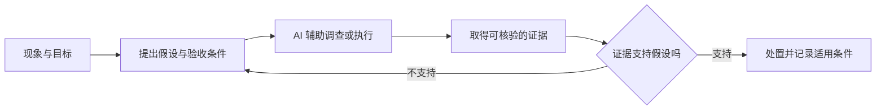

# 第 1 章 · AI 时代工程师的真实处境

> 所属：第一部分 · 处境与角色  ·  [← 返回目录](../README.md)

凌晨三点，服务报出大量 `too many open files`。你把告警和日志交给 AI，它建议重启。重启后服务恢复，告警消失。这次处置可能完全正确：事故中先恢复服务，通常比当场追完根因更重要。

但有一个问题还没回答：这是连接泄漏、文件未关闭，还是正常流量增长撞到了进程限制？如果重启之后没有留下证据，也没有继续验证，下一次告警到来时，你仍然只能重启。

AI 缩短了从现象到行动的距离，却未必缩短从现象到理解的距离。这本书从这里开始：**当生成方案越来越容易，工程师如何保留验证方案、修正判断和承担后果的能力？**

---

## 外包了工作，也可能外包了反馈

工程师一直在向工具外包工作。计算器替我们计算，IDE 帮我们查 API，自动化系统替我们执行重复操作。外包本身没有问题；关键在于，工作交出去以后，我们还能不能发现它何时失效。

以文件句柄告警为例，完整的排查过程会留下几次反馈：你猜是连接泄漏，但 `lsof` 显示增长的是普通文件；你怀疑业务请求触发，但空闲时句柄数仍在增加；最后定位到一个后台任务。每次预测落空，都在修正你对系统的理解。下次遇到类似现象，你会更快排除错误方向。

如果工作流变成"贴日志 → 接受建议 → 告警消失"，这些反馈就可能一起被省掉。你学到的是某个动作曾经有效，却不知道它有效的条件。这里把这种现象称为**认知外包**：连同任务一起交出去的，还有形成假设、检查证据和更新理解的过程。

这是一种需要防范的工作流风险，并不意味着使用 AI 必然损害能力。AI 也可以列出替代假设、帮助解释陌生的系统调用、设计反证实验。区别在于：你的工作流是否仍要求你提出预测，并用系统中的证据检验它。

---

## 最容易被省掉的三种工作

认知外包通常没有明显的起点。它藏在一些看似合理的省时动作里。

第一种是**区分症状缓解与原因解释**。重启解决了当前不可用，不等于证明了根因。AI 建议延长超时，也可能让某些请求完成，但如果请求仍占着数据库连接，驻留时间增加还可能加重拥塞。处置有效，只能支持"这次缓解了症状"，不能自动支持它附带的整套解释。

第二种是比较方案的前提。AI 建议用 Redis 做分布式锁，示例代码也跑通了。评审仍要追问：需要保护什么不变量？租约过期后旧持有者还能不能写入？现有数据库事务能否覆盖这个边界？"能运行"提供了一份执行证据，尚未回答故障条件下是否仍然正确。判断所需的约束，往往来自你的业务和系统，不能指望模型自行补全。

第三种是在信息不足时继续调查。拿到一个流畅解释以后，我们很容易停止搜索。一个可检验的做法是，在采纳前写下："如果这个解释成立，我还应该看到什么？什么证据会让我放弃它？"如果无法回答，说明调查尚未收敛，即使方案写得很完整。

三种工作分别对应因果、约束和反证。它们都需要技术知识，也需要接触真实系统。只保留最终的确认按钮，很难持续练到这些能力。

---

## 任务越完整，验收越需要设计

当 AI 只补全一行代码时，人容易把它放回上下文逐行检查。当它一次改完一个模块，甚至调用工具完成整个任务时，检查对象变成了行为、状态变化和副作用。验收的单位变了，逐行浏览就可能不够。

但任务大，不意味着只能凭感觉验收。你可以让复杂任务产生清晰的中间证据：变更影响了哪些对象，哪些约束经过检查，哪些测试覆盖了失败路径，如何撤回已经发生的动作。一个很长的任务，如果证据充分，可能比一条看似简单却无法验证的命令更容易评审。

因此，授权 AI 做多少事，应该同时考虑两种成本：完成任务的成本，以及发现错误、恢复现场的成本。生成一个方案很便宜，不代表确认它安全也很便宜。如果验收仍需要另一轮同样复杂的调查，自动化只是把工作移到了后面。

---

## 在事故处置里保留判断力

生产事故不适合为了学习而延迟恢复。前面的文件句柄案例，可以保留一条很短的证据链：

1. 在不耽误恢复、且操作安全的前提下，采集进程限制、句柄类型分布和增长趋势。
2. 记录当前假设、重启的预期效果，以及哪些现象说明它没有解决问题。
3. 服务恢复后核对结果，把根因调查交给明确的负责人继续推进。

这三个动作不要求你亲手完成每条命令。AI 可以协助采集、整理和分析；你需要理解证据如何支持结论，并知道哪些问题仍然没有答案。若现场不允许采集，也应记录证据缺口，避免复盘时把猜测写成事实。

平时学习则可以刻意留一小段独立思考：先预测，再使用 AI，对照实际结果。是否需要减少 AI 辅助，可以用一个具体信号判断：离开它以后，你还能否解释方案的前提、识别失效条件，并选择下一项验证？如果这些能力稳定，就没有必要仅因使用频繁而限制工具；如果解释越来越依赖复述答案，就需要调整工作流。

这一章留下的要求很小：每次采纳一个重要建议，至少说清它依赖什么证据，以及什么情况会让你改变决定。下一章将把这个要求放到 SRE 架构师的职责里，讨论哪些责任需要重新设计。

---

## 接下来

- **下一章**：[第 2 章 · SRE 架构师的角色迁移](02-SRE架构师的角色迁移.md) —— 运维对象改变后，谁定义成功、谁设计控制、谁负责恢复
- **关联练习**：[Unit 0 · AI 大模型上手](../练习/Unit0-AI大模型上手/总览.md) —— 从最小工作流开始保留验证证据
- **深入专题**：[深入 09 · 何时不该用 AI](../深入/09-何时不该用AI.md) —— 把验证成本带进场景判断

复习：[核心概念卡](../复习/核心概念卡.md) · [Active Recall 题库](../复习/Active-Recall题库.md)

---

← [引章](../01-引章-大模型速览.md)  ·  [📖 目录](../README.md)  ·  [第 2 章 →](02-SRE架构师的角色迁移.md)
