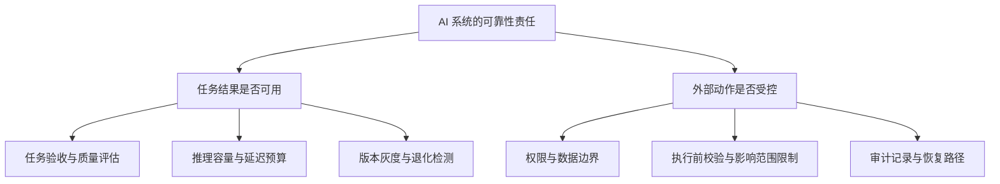

# 第 2 章 · SRE 架构师的角色迁移

> 所属：第一部分 · 处境与角色  ·  [← 返回目录](../README.md)

一个事故助手上线了。模型 API 的可用性达到约定目标，网关没有报错，助手却引用了已经废弃的 runbook，建议值班人员重启错误的集群。模型服务团队说请求成功，检索团队说文档确实存在，应用团队说输出格式正确。每个组件都有负责人，整个任务的失败却落在了团队之间。

上一章讨论了个人如何保留判断力。这一章讨论组织中的同一个问题：**谁来定义任务成功的条件，并把这些条件变成能执行、能观察、能恢复的系统约束？** SRE 架构师的角色迁移，首先发生在这个接缝上。

---

## 变化的是可靠性契约的内容

传统系统也存在语义错误：查询返回了过期数据、扣款金额算错、搜索结果与问题无关。SRE 方法并非只能处理 HTTP 状态码，[Google SRE Workbook 的 SLO 实践](https://sre.google/workbook/implementing-slos/)也把正确性、新鲜度、质量和覆盖率列为可以衡量的服务属性。

AI 系统让这些问题更集中地进入生产链路。一段输出可能语法正确、事实部分成立，却不适合当前业务；同一任务在不同输入、上下文或模型版本下，成功率也可能不同。完全确定的测试仍有用，但覆盖开放任务时，还需要任务样本、规则检查、人工评审和持续质量观测。

与此同时，AI 开始通过宿主程序调用工具、修改外部状态。事故助手从"建议重启"变成"执行重启"，改变的不只是功能：错误建议原本还可能被人拦下，现在可能直接影响生产。可靠性契约因此要同时覆盖结果质量和动作边界。

原有的 SLO、失败域、容量规划、灰度和回滚仍然适用。新增的工作，是把难以穷举的语义失败，以及模型驱动的外部动作，接进这些控制机制。

---

## 两类工作，分别守住输出与动作

第一类是为 AI 系统提供可靠服务。对事故助手来说，既要知道模型是否响应，也要知道它是否找对服务、引用有效证据、在允许的时间内给出可操作的建议。模型、prompt、检索索引和工具配置都可能改变结果；发布与回滚需要记录这组版本，而不只记录一个模型名。

第二类是约束 AI 操作生产的行为。授权不能只写在 prompt 里，还应落实到工具接口、凭证、网络出口和执行环境。例如，助手可以读取指定服务的日志，但无法读取别的租户数据；它只能向批准的目标发送内容；重启动作只能作用于明确的资源集合，并受并发和影响范围限制。[第 6 章](../知识/06-AI自治与上下文架构约束.md)会展开这些边界及 prompt injection 风险。

两类工作相互依赖，却不能彼此替代。回答质量高，不能证明工具权限安全；权限足够小，也不能证明建议有用。前者需要质量证据，后者需要执行层的约束和验证。

---

## 用一次上线评审说明职责如何迁移

假设团队希望把事故助手从只读分析升级为自动重启。评审不能停在"模型测试表现不错"，至少要把下面四个问题落到产物上。

| 评审问题 | 需要的证据或控制 |
|---|---|
| 它什么时候可以采取动作？ | 明确触发条件、适用服务和必须满足的前置检查 |
| 它可能把什么判断错？ | 服务识别错误、过期证据、错误恢复建议等任务样本 |
| 一次判断错了能影响多大？ | 工具端资源白名单、操作数量与并发上限 |
| 动作之后如何确认并收场？ | 恢复指标、停止条件、审计记录和人工接管路径 |

这里的"可回滚"也要具体。恢复配置版本，不会自动恢复已经中断的连接；停止 Agent，也不会撤销已经发出的外部请求。若副作用无法直接撤销，需要设计补偿或降低授权范围，不能把一个回滚按钮当成所有后果的逆操作。

是否允许自动执行，应由业务损失、验证能力和控制效果共同决定。对证据不足、后果难以恢复的动作，先保留审批；当相应失败路径得到覆盖、权限限制经过验证、恢复过程可演练时，再重新评估授权。没有一条按技术名称划定的永久边界。

---

## 责任需要共同设计，也需要明确归属

这些工作通常跨越应用、ML、平台、安全和 SRE 团队。SRE 不必拥有所有组件，但需要参与端到端服务目标、发布门禁、容量保护和事故恢复的设计。否则，到了值班时才发现风险，却没有任何控制手段。

一个可落地的责任划分是：业务与应用负责人定义任务是否有用、什么错误不可接受；ML 或评估负责人维护样本和判定标准；平台与安全团队提供服务、权限和隔离控制；SRE 与上述团队共同确定可运行的目标、监控和恢复策略。每项产物都需要明确的维护者，整个服务也需要一位有权推动跨团队修复的负责人。具体由哪个部门承担，取决于组织，不能只凭岗位名称决定。

影子流量也要遵守这个边界：把请求复制给新模型进行对比时，应隔离会写入外部状态的工具。一次为了验证质量的回放，不应在生产里重复执行重启。

---

## 判断力如何变成可交付的能力

生成排查步骤和方案草稿的成本在下降。这会改变工作分配，但不足以推出"执行能力都在贬值、判断能力都在升值"。不理解实现细节，很难识别方案中的隐藏前提；不接触生产反馈，判断也容易变成经验口号。

对架构师而言，更有持续价值的产出，是把知识和经验转成一套他人也能执行的决定：为什么选择这个方案，接受了哪些风险，哪些证据允许发布，发生什么变化就必须收回决定。承担责任，需要有相应的技术理解、控制权限和可观察证据。

前面的事故助手评审，最终应留下任务验收标准、动作边界、发布与停止条件、恢复责任人。它们让"我认为能上线"变成团队可检查的承诺。这也是下一章讨论学习能力的原因：系统和工具会变，架构师必须持续更新支撑这些承诺的知识。

---

## 接下来

- **下一章**：[第 3 章 · 学习能力才是新的护城河](03-学习能力才是新的护城河.md) —— 如何持续修正支撑工程判断的心智模型
- **关联练习**：[贯穿项目 · SRE 事故助手](../练习/贯穿项目-SRE事故助手.md) —— 为一个具体系统逐步建立上述产物
- **后续主线**：第 4—10 章分别展开链路可靠性、推理服务、自治边界、多智能体、质量观测、组织与工程底座

复习：[核心概念卡](../复习/核心概念卡.md) · [Active Recall 题库](../复习/Active-Recall题库.md)

---

← [第 1 章](01-AI时代工程师的真实处境.md)  ·  [📖 目录](../README.md)  ·  [第 3 章 →](03-学习能力才是新的护城河.md)
