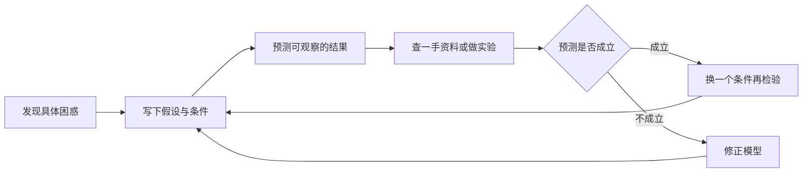

# 第 3 章 · 学习能力才是新的护城河

> 所属：第一部分 · 处境与角色  ·  [← 返回目录](../README.md)

你记得某个推理框架的启动参数，也按旧经验给服务做过容量估计。升级之后，调度策略、缓存方式和指标口径发生变化，原来的经验不再直接适用。此时真正困难的工作，是分清哪些机制仍然成立，哪些假设已经失效，以及该做什么实验重新确定边界。

上一章把架构师的工作落在了可检查的工程承诺上。要长期维护这些承诺，就必须能更新知识，而不是只积累结论。本章所说的**学习能力**，是构建一个能解释现象、产生预测，并在预测失败后得到修正的心智模型的能力。

---

## 怎样判断自己是否理解了

心智模型不必复杂。它可以是一张因果图、一组约束，或几条带条件的规则。区别在于，遇到新情形时，它能不能帮助你推出尚未读到的结论。

例如，你读到了"上下文越长，KV cache 占用通常越大"。能复述这句话，只说明你记住了一条关系。如果进一步理解缓存为每条活跃序列保存状态，就可以提出预测：在模型、缓存精度和显存预算固定，且不考虑共享等优化时，平均驻留上下文变长，可容纳的并发就会下降。

这个预测仍不完整。服务总吞吐是否下降，还取决于调度、批处理和计算瓶颈；已经预分配的缓存池，也可能让 GPU 显存占用曲线看起来不变。于是你需要区分物理显存占用、缓存块使用量、活跃请求和排队请求。这些新增区分，就是模型变精确的过程。

理解不等于马上给出正确答案。更有用的检验是：你能否写出预测所依赖的条件，选择能检验它的观测，并解释结果为什么没有符合预期。

---

## 学习的阻力，常出现在验证之前

主动学习需要经过几次不舒服的转换：从"看不懂"到说清哪个关系不懂，从模糊猜测到可检验的预测，再从预测失败到承认原来的模型有缺口。这里把这段暂时无法形成完整解释的过程称为"困惑期"。

AI 可以帮助你度过它，也可能让你跳过它。直接拿到一份流畅解释，很容易产生熟悉感；但能顺着解释点头，与能独立预测一个变体问题，是两回事。同样的风险也存在于读书、听课和看教程，并非 AI 独有。AI 让随时取得完整答案变得容易，因此更需要主动保留检验理解的环节。

[Anthropic 在 2026-01-29 公布的随机对照研究](https://www.anthropic.com/research/AI-assistance-coding-skills)让不熟悉 Trio 的开发者完成入门任务，随后做即时测验。AI 辅助组的平均理解成绩较低，但这不能直接证明长期能力退化；不同使用方式的分组分析也不是随机分配，不能当成因果结论。它支持把任务完成与理解分开测量，尚不能证明本书 B1/B2/B3 在所有场景都优于其他训练方法。

这是一项学习设计上的判断，不能据此断言使用 AI 必然削弱思考能力。我们能直接观察的是：自己是否越来越少提出问题、是否只能复述、能否迁移到新的情境。调整方法，应以这些表现为依据。

---

## 卡住时怎样获得有效帮助

困惑有不同原因，不能一概要求"再熬一会儿"。如果连术语都不认识，继续硬读可能只会增加负担；如果已经有一个自洽解释却不愿验证，继续读更多材料也可能是在回避关键问题。

| 当前状态 | 下一步动作 | 怎样检查是否有进展 |
|---|---|---|
| 缺少术语或前置知识 | 查定义，请 AI 给最小例子，再回到原文 | 能用自己的例子解释术语 |
| 知道概念，但关系不清 | 画输入、状态与输出，请 AI 提示缺失关系 | 能指出具体卡在哪条关系 |
| 已有假设，尚未验证 | 查源码、文档或做小实验 | 结果支持或推翻了一个预测 |
| 能解释当前例子 | 改变一个条件，尝试独立推演 | 能说明原结论何时不成立 |

向 AI 求助，不必等到自己已经有完整假设。你可以让它拆小问题、解释必要前提、给一个提示，或提供反例。获得帮助后，再收起答案，用自己的话重建解释，预测一个没有被演示过的情况。

验证时还要区分证据来源。AI 认可你的推理，并不能替代真实系统的测量，也不能证明它引用的材料确实支持结论。对工程判断，优先回到一手文档、代码和可重复的实验；对仍有争议的解释，保留不确定性。

---

## 把一次阅读变成一次模型更新

仍以上下文与容量为例。你准备读推理服务的容量章节，可以先写三句话："我认为单请求状态随上下文增长"、"因此固定缓存预算下的并发会下降"、"但我不知道排队延迟会怎样变化"。

读完后，做一个小对照：固定模型、硬件、输出长度分布和请求到达方式，改变输入长度，同时记录缓存块使用量、活跃并发、排队时间和 TTFT。即使没有 GPU，也可以先根据章节里的公式手算两个负载，再核对推导。

如果长输入使 TTFT 上升，不能立即把原因归给 KV cache：更长的 prefill 本身也会增加工作量，排队和缓存命中变化也可能参与其中。下一步应缩小实验，只改变一个关键条件，或者补充能区分这些解释的观测。

最后，留下一份短记录：原预测是什么，证据是什么，哪里改了，哪些条件还没测。这比记录"今天学会了 KV cache"更有价值，因为以后环境变化时，你能知道该重查哪些假设。第 4、5 章就将用这种方式，把直觉变成可以复算的链路与容量模型。

---

## 三个训练动作各自保留什么

第四部分的 B1 / B2 / B3，是把上述过程嵌入日常工作的一组练习：

- **B1 预测-对比（每日约 5 分钟）**：使用 AI 或阅读材料前，先写一个预测和一个不确定点。对照资料或实际结果，记录差异。目标是让理解中的缺口显现出来，不能只统计自己猜对了几次。
- **B2 AI-挑错式写作（每周 30—60 分钟）**：自己写出本周产物的初稿，让 AI 挑反例、技术错误和遗漏，再自行核验并修改。写作迫使你交代前提与因果；接受多少修改，并不能单独代表学得好坏。
- **B3 无 AI 深度块（每周 45 分钟起）**：给一段一手材料或一个难题留出连续时间，暂时移开即时答案，练习自己拆问题、推演和记录卡点。卡在前置知识时应先补齐，再回到任务，时长只是安排，不是能力评分。

这些限制服务于训练：让你能看清自己独立完成了哪些思考。它们不要求把所有工作都改成无 AI 模式。若在独立解释、延迟复测和新情境预测中都表现稳定，可以调整训练难度和辅助方式；若只会复述现成答案，就应缩小任务，补做建模与验证，而非单纯延长苦读时间。

一周后，找一个未见过的变体再推演一次。如果仍能说明条件、做出预测，并在失败时修正，知识才开始转成可以使用的能力。

---

## 接下来

- **进入第二部分**：[第 4 章 · 系统架构与复合 AI 可靠性数学](../知识/04-系统架构与复合AI可靠性数学.md) —— 先为链路成功建立一个带明确假设的模型
- **关联练习**：[第 18 章 · 三个核心训练动作](../练习/10-三个核心训练动作.md) —— B1 / B2 / B3 的执行方法与产物
- **关联附录**：[附录 A · 每月自检表](../附录/A-每月自检表.md) —— 用持续产出检查学习效果

复习：[核心概念卡](../复习/核心概念卡.md) · [Active Recall 题库](../复习/Active-Recall题库.md)

---

← [第 2 章](02-SRE架构师的角色迁移.md)  ·  [📖 目录](../README.md)  ·  [第 4 章 →](../知识/04-系统架构与复合AI可靠性数学.md)
