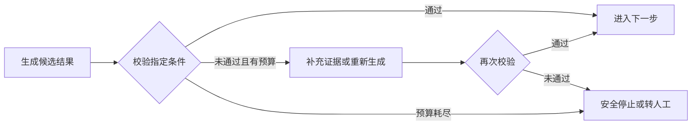

# 第 4 章 · 系统架构与复合 AI 可靠性数学

> 所属：第二部分 · 核心能力  ·  [← 返回目录](../README.md)

事故助手依次识别服务、检索文档、读取指标、生成建议、选择动作、提交结果。每个环节单独测试时都表现不错，合在一起却经常失败。原因可能很简单：一个任务需要多个环节共同成立，单个环节的成绩不足以说明整条链路的成绩。

前三章要求我们保留可检验的判断。从本章开始，把这件事落实到系统设计：先定义什么算成功，再算清增加步骤、插入校验和允许重试分别改变了什么。

---

## 先定义成功，再使用乘法

设事件 $E_i$ 表示第 $i$ 步满足本任务要求。如果任务成功要求每一步都正确，那么：

$$
P_{\text{success}} = P(E_1 \cap E_2 \cap \cdots \cap E_n)
= P(E_1)\prod_{i=2}^{n}P(E_i\mid E_1,\ldots,E_{i-1})
$$

这是概率的链式法则，不要求各步独立。只有在各步正确与否相互独立时，才可以直接把各步的边际正确率相乘。另一种可用口径，是每个 $p_i$ 都测量"此前各步正确时，该步正确的概率"；此时连乘的是条件概率。

为了看清量级，先做一个简化算例：6 个必要环节，每步正确率均为 95%，相互独立，任何一步错误都会导致任务失败。这里的 95% 是教学假设，不代表某类模型的实测水平。

$$
P_{\text{success}}=0.95^6\approx73.5\%
$$

| 必要步数 | 全部正确的概率 | 至少一步出错的概率 |
|---|---|---|
| 3 | 85.7% | 14.3% |
| 6 | 73.5% | 26.5% |
| 10 | 59.9% | 40.1% |
| 15 | 46.3% | 53.7% |

这张表说明：当新增步骤只是再加一个必须成功的环节时，它会消耗成功概率。它不能证明"Agent 步数越多一定越差"。新增的检索、测试或纠错步骤，也可能改善已有步骤的质量；如果后续能修复前面的错误，任务成功就不再等价于"每一步都曾经正确"，需要按实际分支重新计算。

这里的 step，是可以观察、定义验收条件的工作流环节，例如一次检索、模型调用或工具操作。不要把模型内部不可观察的推理活动、输出 token 数，直接换算成这张表里的步数。

---

## 真实链路中，最危险的是估错了概率

假设检索环节把另一个集群的 runbook 带进上下文。后续模型依据它给出建议，引用检查确认文档存在，动作选择也与建议一致。后面几步彼此自洽，整个任务仍然错了。引用存在性检查无法证明文档适用于当前集群。

这类共同输入会使错误相关。相关性并不意味着端到端成功率一定比独立模型更低；它意味着只知道各步的边际正确率，无法唯一确定它们同时正确的概率。把每步都放在人工准备好的干净输入上测一遍，再把分数相乘，也无法反映真实链路的错误传播。

因此，方案评审中的概率账应交代三件事：每步正确的定义、样本来自什么分布、前序失败后链路如何继续。设计阶段可以用估计做敏感性分析；发布前仍需在同一批任务上跑完整链路，用 trace 定位失败，并对比分步估计与端到端实测。

步骤成功也未必代表业务成功。结构化校验通过，只证明格式符合约束；工具返回成功，只证明某次操作完成。事故是否缓解、建议是否适用，还需要各自的验收证据。

---

## Step 预算约束的是未经证明的复杂度

如果简化模型中每步正确率都是 $p$，希望全部正确的概率至少为 $S$，则允许的必要步数满足：

$$
p^n\ge S\quad\Longrightarrow\quad
n\le\left\lfloor\frac{\ln S}{\ln p}\right\rfloor,\qquad 0<p,S<1
$$

例如，假设每步为 99%，目标为 95%，最多允许 5 个这样的必要步骤：$0.99^5\approx95.1\%$，而 $0.99^6\approx94.1\%$。若每步只有 95%，同一目标下只容得下 1 步。这不是要求把所有流程压成一次模型调用，而是在提示：仅靠当前单步质量和串联方式，设计没有足够余量。

实际的 Step 预算至少要同时约束三件事：正常路径允许哪些环节，失败路径最多重试或循环多少次，以及总延迟、token 和外部操作预算。模型调用少了一次，若因此失去必要证据，端到端质量可能更差；增加一次验证，若能降低错误执行的风险，就可能值得。

> [!WARNING]
> **何时需要重审压缩步数的决定**：当新增步骤在代表性任务上显著改善了端到端结果，或单步失败已经不再是主要瓶颈时，应重算预算。没有通用的"跨过 99.9% 就不必管步数"的阈值；判断取决于任务目标、链路长度、失败后果和恢复机制。可回滚能降低损失，但不会自动提高语义正确率。

---

## Verifier 先改变错误流向，再谈提高成功率

**Verifier** 是检查某项条件的校验节点。它能检查的内容，取决于可获得的证据：schema 校验检查结构，引用检查核对来源，权限检查限定动作，任务评审判断建议是否适用。不能因为一个节点叫 verifier，就假设它验证了全部正确性。

校验后至少有三种结果：正确输出被放行，错误输出被放行，以及请求被拦截或转交兜底。被拦下的错误不再进入后续动作，但任务也可能尚未完成。

因此，无重试的 gate 也可能很有价值：它可以牺牲完成率，减少错误动作。只有重试、修复或兜底真正解决了问题，才可能进一步提高正确完成率。把这两种收益混在一起，会让团队用"拦下了很多错误"来证明"任务更容易完成"。

### 一笔口径一致的账：校验和一次重试

仍用 6 步、每步 95% 的独立教学模型。只在第 2 步后加 gate，且 gate 只检验该步，不检查前后其他步骤。设：

- $p=0.95$：首次生成正确的概率。
- $f=0.01$：正确结果被误拒的概率。
- $d=0.99$：错误结果被检出的概率。
- $r=0.95$：在首次被拒之后，重新生成正确的条件概率。

两次校验使用相同的 $f,d$，并假设这些误判率适用于重试结果。拒绝后最多重试一次，重试结果也必须再次过 gate；第二次被拒就停止。暂不计超时、校验服务故障和额外成本。

首次被拒的概率为：

$$
a=pf+(1-p)d=0.95\times0.01+0.05\times0.99=0.059
$$

该步最终正确且被放行的概率为：

$$
q=p(1-f)+ar(1-f)
=0.9405+0.059\times0.9405=0.9959895
$$

该步错误却被放行的概率为：

$$
b=(1-p)(1-d)+a(1-r)(1-d)=0.0005295
$$

其余概率 $u=1-q-b=0.003481$，对应两次都未通过、请求停止。对照三种设计：

| 第 2 步的设计 | 正确且放行 $q$ | 错误且放行 $b$ | 停止 $u$ |
|---|---|---|---|
| 无校验 | 95% | 5% | 0% |
| 校验，拒绝即停止 | 94.05% | 0.05% | 5.9% |
| 校验，最多重试一次并复检 | 99.59895% | 0.05295% | 0.34810% |

只有第 2 步改善，其他 5 步仍各为 95%。三种设计的端到端正确完成率依次为：

$$
\begin{aligned}
\text{无校验：}&\quad 0.95^6\approx73.5\%\\
\text{校验后停止：}&\quad 0.95^5\times0.9405\approx72.8\%\\
\text{校验并重试一次：}&\quad 0.95^5\times0.9959895\approx77.1\%
\end{aligned}
$$

无重试时，正确完成率略降，错误放行却大幅减少。加重试后，完成率提高，但错误放行概率也比只校验略高，因为增加了一次接受候选结果的机会。表里的 $b$ 只描述第 2 步，不能当成整条链路的错误交付率；后面仍可能出错。

这个策略平均执行 $1+a=1.059$ 次第 2 步生成，也执行同样次数的校验。它能否在期限内完成、是否值得这份成本，还需要另外测量。尤其要测 $r$：若失败来自同一份过期资料，原样重试的成功率可能远低于 95%。生成器与 judge 使用相同的错误信息时，校验也可能重复认可同一个错误。两种情况都会削弱算例里的收益。

---

## 把概率账带进架构评审

回到事故助手。一份可以评审的设计，应能沿着下面的顺序说清楚：

1. **定义结果**：什么算任务正确完成，什么算安全停止，什么算错误执行；三者分别如何测量。
2. **画出路径**：标出正常路径、校验、重试、兜底与外部副作用，给每条循环设上限。
3. **记录假设**：每步正确率和校验误判率从哪里来，是否依赖前序输入，哪些数字还只是估计。
4. **比较完整方案**：在同一组任务上比较完成率、错误交付、延迟和成本，并检查业务损失最大的失败样本。

这笔账的作用，是暴露设计依赖的条件，并找到最值得验证的地方。它不能凭几个估计数字生成一份可信的 SLA。只有把假设与完整链路的证据反复对照，Step 预算和 verifier 才会成为工程控制。

下一章将下沉到承载这些步骤的推理服务：即使工作流设计合理，排队、流式中断和服务质量退化，也可能让单次调用达不到它所承诺的条件。

---

## 接下来

- **关联练习**：[Unit 4 · 复合 AI 可靠性数学](../练习/Unit4-复合AI可靠性数学/总览.md) —— 为自己的链路建立 Step 预算与校验方案
- **下一章**：[第 5 章 · AI 推理服务的可靠性工程](05-AI推理服务的可靠性工程.md) —— 定义并守护推理服务的承诺
- **深入专题**：[深入 10 · AI 系统事故模式库](../深入/10-AI系统事故模式库.md) —— 检查实际失效路径

复习：[核心概念卡](../复习/核心概念卡.md) · [Active Recall 题库](../复习/Active-Recall题库.md)

---

← [第 3 章](../理念/03-学习能力才是新的护城河.md)  ·  [📖 目录](../README.md)  ·  [第 5 章 →](05-AI推理服务的可靠性工程.md)
