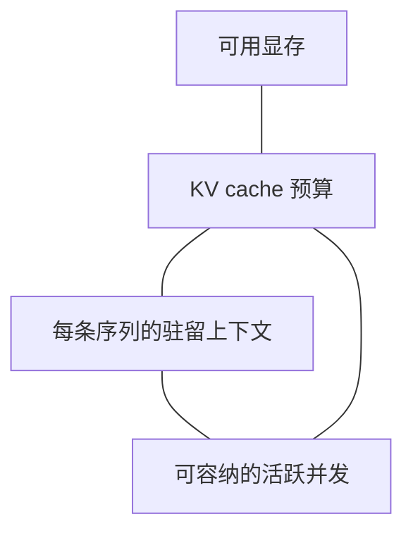

# 第 5 章 · AI 推理服务的可靠性工程

> 所属：第二部分 · 核心能力  ·  [← 返回目录](../README.md)

事故助手的请求返回了 HTTP 200，第一段文字也很快出现，但后面的流停了十几秒，最终缺少操作建议。另一条请求完整返回，却引用了过期文档。只看状态码和首包时间，这两次都可能被记录为成功。

上一章计算链路是否能正确完成。本章讨论支撑链路的推理服务：哪些结果值得承诺，在哪里测量，以及容量保护和发布控制怎样守住这些承诺。SLO 方法仍然适用，但必须把流式完成、任务质量和工作负载形状纳入定义。

---

## 先选测量边界，再选指标

模型引擎、网关和用户侧看到的延迟不同。引擎测量可能不包含网关排队与重试，用户侧还会经历网络和界面缓冲；事故助手的总耗时中，又有检索和工具调用。未说明起止点的"TTFT 变快了"，无法直接证明用户更早拿到了有用内容。

最少需要区分两个边界：用户或应用入口处衡量任务体验，推理服务入口及引擎内部定位资源和调度问题。通过同一条 trace 关联它们，才能知道时间花在模型里，还是花在了模型之外。

[Google SRE Workbook](https://sre.google/workbook/implementing-slos/)建议用"好事件数 / 总事件数"表达 SLI。沿用这个方式时，要把对象、分母和失败条件一并写出：没有生成首 token 的请求，不能从延迟达标率中悄悄消失；过载拒绝和流式中断，也不能因为没有完整响应而被漏记。

### 延迟至少分成三个问题

- **TTFT（首 token 延迟）**：从约定的入口收到请求，到第一个输出 token 可见。它可能包含排队、输入处理、prefill 和传输；不等于纯 prefill 时间。若产品先输出固定提示，应另测首段有用内容的时间。
- **生成过程是否持续**：请求级 TPOT（平均每个后续输出 token 的耗时）描述整体生成速度；输出事件之间的间隔则帮助发现中途停顿。一次输出可能包含多个 token，两者不能直接混用。
- **完整响应何时结束**：从入口到满足完成条件的输出到齐。快速出现第一段文字，无法抵消最终被截断或中断的失败。

在同一测量边界下，对输出 token 数 $N_{\text{out}}>1$ 的请求，可用下面的请求级口径：

$$
\text{TPOT}=\frac{T_{\text{last token}}-T_{\text{first token}}}{N_{\text{out}}-1}
$$

只有一个输出 token 的请求不适合用这个式子评估生成速度，应单独统计。[vLLM 的指标文档](https://docs.vllm.ai/en/latest/design/metrics/)明确区分请求级 TPOT 与输出事件间隔；接入具体版本时，应核对其采集边界和单 token 请求的处理方式。服务整体 tokens/s 则衡量聚合吞吐，高吞吐不保证单个用户没有长时间等待。

---

## 从指标清单走到可以执行的 SLO

容量和质量指标都很重要，但并非每个 dashboard 指标都应成为用户 SLO。GPU 利用率、缓存块占用和排队请求数，主要用于解释风险、控制资源；完整响应率和按时完成率，才更直接对应用户得到的服务。

以只读事故助手为例，可以写出下面这份最小规格。数字都是教学示例，不是推荐目标，应由业务容忍度和实测结果确定。

| 目标 | 好事件 | 分母与窗口 |
|---|---|---|
| 首次输出及时 | 入口收到请求后 2 秒内出现首 token | 约定负载范围内的有效请求；滚动 7 天 |
| 完整交付及时 | 30 秒内完整返回，未异常中断或意外截断 | 同上；滚动 7 天 |
| 建议质量合格 | 引用有效且适用、关键结论有证据、满足任务规则 | 同期按任务分层抽样并完成判定的请求 |

例如，前两项各自以 99% 为目标，质量合格率以 95% 为目标。若窗口内有 10,000 个符合口径的请求，每项 99% 目标各允许 100 个坏事件；同一请求可以同时消耗两项预算。对有效请求的过载拒绝和服务端中断应计为失败，输入违规等排除项则要预先定义并单独报告，不能事故后再改分母。

质量项的分母不同：对 1,000 条样本得到的合格率，只直接描述这组样本。要估计生产总体，需说明抽样方法、各任务占比、样本量和不确定性，不能直接把样本失败数当成全量质量错误预算。

各项达标率也不能直接相乘来推算"总体成功率"。若业务关心"及时、完整且正确"，应在同一批请求上计算联合结果。第四章关于条件概率与相关性的限制，在这里同样适用。

### 让质量指标对应具体失败

事故助手可以分别检查：输出结构是否符合约定、引用是否存在、引用是否适用于当前服务、关键建议是否有证据、是否越过动作权限。格式规则适合自动全量检查；适用性和语义判断往往需要人工或经过校准的 judge。

不同检查应保留各自的通过率，避免一个平均分掩盖严重错误。还应跟踪拒答、转人工和有效完成率：把所有问题都拒绝，可以降低错误建议，却无法提供有用服务。对 judge，要按任务类型比较它与人工判定的分歧，尤其关注它放过了哪些错误。质量监控的具体管线在第 8 章展开。

> [!WARNING]
> **何时需要重审指标集**：本章的 token 速度与 KV cache 模型主要针对自回归 Transformer 服务。若主力推理路径改成非流式或其他架构，应重审这些机制指标；若从交互服务改为离线批处理，也应把交互延迟目标改为交付时限。及时、完整、符合任务要求这几项服务目标仍需保留，但测量实现会变化。

---

## 容量规划有两条约束链

同样是每秒 8 个请求，短问短答与长文分析对资源的需求不同。输入长度影响 prefill 和上下文状态，输出长度影响 decode、驻留时间及后续缓存增长；并发、缓存命中、调度和硬件决定它们怎样互相干扰。QPS 是负载描述的一部分，必须和这些条件一起使用。

### 显存链：能放下多少活跃状态

prefill 是处理输入、建立后续生成所需状态的阶段。对于本章讨论的模型，KV cache 保存活跃序列的中间状态，避免生成每个新 token 时重算全部历史。它通常随已缓存上下文长度近似线性增长，并随同时驻留的序列增加。

对给定设备或分片，先满足：

$$
M_{\text{weights}}+M_{\text{KV}}+M_{\text{runtime}}+M_{\text{reserve}}
\le M_{\text{available}}
$$

运行时开销包含工作区等，预留项用于覆盖波动。忽略前缀共享、卸载等机制时，可作粗估：

$$
M_{\text{KV}}\approx\sum_{j=1}^{N_{\text{active}}}L_jm_{\text{KV/token}}
$$

其中 $L_j$ 是第 $j$ 条序列当前缓存的长度，包含已生成部分；每 token 状态量取决于模型结构、缓存精度和分片方式。多卡部署应检查各卡约束，不能仅凭总显存判断可行。若框架预分配缓存池，物理显存占用可能保持高位，此时更需要观察缓存块使用率、抢占和排队。

### 性能链：能在期限内完成多少工作

即使状态放得下，计算与调度也可能让延迟超标。输入通常驱动 prefill 工作，输出驱动 decode 工作；长 prefill 还可能影响已有请求的生成间隔。缓存命中会改变实际计算量，批处理又会改变资源效率，因此显存估算只能给出一个约束，不能直接给出可承诺容量。

用 Little's law 连接 QPS 与并发时，边界必须一致。在稳定、平均值口径下：

$$
N_{\text{active}}=\lambda_{\text{admitted}}\times W_{\text{active}}
$$

这里的到达率是进入推理执行阶段的请求率，$W_{\text{active}}$ 是处于该阶段的平均驻留时间。若把排队也计入时间，得到的是系统内总请求数，不能据此直接估算活跃 KV cache 占用。这是均值关系，不能用 p99 延迟替代平均驻留时间。

### 一次长输出怎样打穿容量

下面是假设负载，用于复算关系，不代表硬件实测。假设 KV cache 预算为 40 GiB，每个活跃请求平均占 0.25 GiB，且执行阶段每秒接纳 8 个请求：

- 平均驻留 12 秒时，活跃并发约为 $8\times12=96$，平均 KV 需求约为 $96\times0.25=24$ GiB。
- 若长输出使驻留时间变成 30 秒，要维持同样接纳率，就需要约 240 个活跃请求。即使暂按每请求仍为 0.25 GiB，需求也达到 60 GiB；实际缓存还可能随生成继续增长。

系统无法在原约束下维持这份负载，只能减少接纳、增加排队、抢占或降级。若排队没有上限，TTFT 会继续恶化；客户端重试又可能放大到达流量。单纯增加超时时间，不会补出缺失的容量。

因此，可承诺容量应来自满足 SLO 的压测：固定模型与服务配置，覆盖输入/输出长度、缓存命中和任务类型的代表性分布，逐步增加到达率，同时观察排队、TTFT、生成停顿、完整交付和质量。除稳态外，还要验证突发流量与长请求混入时的行为。具体公式和部署例子见[深入 05 · 容量规划](../深入/05-LLM推理服务的容量规划.md)。

---

## 容量压力需要变成接纳与停止规则

监控指出风险之后，服务还需要明确的控制动作。常用手段包括：限制排队长度和等待时间，为单请求设输入、输出与循环预算，按租户限制并发，对长短请求做隔离，并为重试设置总次数和退避策略。客户端取消之后，也要确认下游计算是否实际停止。

控制手段本身会改变服务结果。截短上下文可能丢失关键证据，切换小模型可能降低质量，限制输出可能造成任务不完整。降级路径必须经过相应任务评估，并在结果和指标中显式标记；不能只因降级后仍返回 200，就认为原承诺已经满足。

阈值应从负载与 SLO 验证中得到。当模型、硬件、调度、流量形状或缓存策略变化后，需要重新验证。某次压测中可用的并发上限，不能作为长期不变的配置常量。

---

## 静默降级：服务还活着，任务已经变差

**静默降级**指服务仍可响应，而质量下降没有被现有告警及时识别。原因可以是模型或 prompt 变化、检索资料过期、错误路由，也可能来自精度、编译器或 kernel 实现。数值差异并不自动等于质量故障，应以任务证据确认影响。

Anthropic 在 2025 年的[三起事故复盘](https://www.anthropic.com/engineering/a-postmortem-of-three-recent-issues)中记录了上下文路由错误、输出损坏和 XLA 编译问题。既有评估未充分捕捉用户报告的退化，问题还随平台与配置变化。其改进包括更敏感的评估和在真实生产系统上持续运行质量检查。

这份案例支持的结论是：离线评估通过，不能证明实际生产路径没有退化。它并不意味着 eval 无法发现问题。有效的检测需要几类信号互补：

- **固定 canary 样本**：反复探测可比较的任务，跟踪质量随版本和时间的变化；应覆盖实际路由，并保留基线。
- **生产任务的分层抽样**：覆盖任务类型、语言、上下文长度、区域和服务版本；避免只看全局平均。
- **用户反馈与失败回放**：把固定样本未覆盖的新问题纳入调查和回归集，同时遵守数据访问边界。

随机输出会产生自然波动，单个样本变差未必代表系统回归。质量告警需要样本量、重复观测或对照证据；明显的权限违规、内容损坏等严重事件，则可以设置独立的处置规则。

### 监控还必须命中真正变化的路径

固定探针如果总走短上下文、固定区域，就可能漏掉长上下文服务池或客户内网的问题。持续 canary 可以跨时间，也可以跨环境，关键取决于探针覆盖了哪里。

调查质量回归时，应保留模型、prompt、检索索引、工具 schema 和服务配置等版本信息，通过配对回放或灰度对照缩小变化范围。只回滚模型名，未必撤回了错误路由、索引或编译产物；恢复动作需要覆盖真正发生变化的对象。跨环境的一致性验证见[深入 30 · 环境漂移](../深入/30-环境漂移与配置可移植.md)。

---

## 网关与引擎需要守住同一份承诺

引擎负责生成，网关却可能决定排队、限流、重试、缓存、上游路由和流式转发。这些行为都会改变用户得到的服务。例如，引擎已经持续输出，代理缓冲却让用户长时间看不到内容；网关切换上游恢复了可用性，却改变了质量。

因此，网关与推理团队需要共享端到端 SLI、请求标识、版本与路由记录，以及可执行的故障处置约定。它们可以由不同团队负责，只要接口、责任和联动机制清楚；是否参加同一个例会，无法单独证明组织设计好坏。更完整的设计见[深入 17 · LLM 网关](../深入/17-LLM网关的SRE视角.md)。

本章结束时，一份推理服务设计应留下四项可评审的产物：带分母和测量边界的 SLO 规格、注明负载分布的容量结果、有上限的接纳与重试策略，以及覆盖实际生产路径的质量检测和回滚方案。它们共同说明，这个服务承诺了什么，以及承诺即将失守时由谁采取什么动作。

---

## 接下来

- **关联练习**：[Unit 3 · 推理 SLO 与静默降级](../练习/Unit3-推理SLO与静默降级/总览.md) —— 把测量规格、容量保护和质量回归做成 dashboard 与 runbook
- **部署验证（可选）**：[贯穿部署线 · H20 推理服务](../练习/贯穿部署-H20推理服务.md) —— 亲手观察 TTFT、KV cache 与缓存命中的变化
- **下一章**：[第 6 章 · AI 自治与上下文架构约束](06-AI自治与上下文架构约束.md) —— 当输出变成外部动作，如何约束授权与影响范围
- **深入专题**：[首包延迟与吞吐](../深入/01-首包延迟与吞吐的影响因素.md) · [Prompt Caching](../深入/02-Prompt-Caching原理.md) · [容量规划](../深入/05-LLM推理服务的容量规划.md) · [分布式推理](../深入/20-单卡装不下的大模型分布式推理.md)

复习：[核心概念卡](../复习/核心概念卡.md) · [Active Recall 题库](../复习/Active-Recall题库.md)

---

← [第 4 章](04-系统架构与复合AI可靠性数学.md)  ·  [📖 目录](../README.md)  ·  [第 6 章 →](06-AI自治与上下文架构约束.md)
