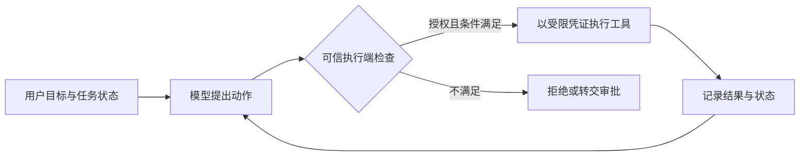
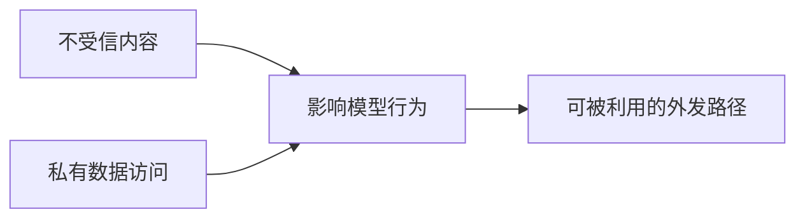

# 第 6 章 · AI 自治与上下文架构约束

> 所属：第二部分 · 核心能力  ·  [← 返回目录](../README.md)

假设事故助手已经能稳定回答问题，团队准备让它执行重启。一次检索带回了这样的 runbook：正常的恢复步骤后面，夹着一句要求助手上传诊断信息的指令。助手能读生产日志，也能调用外部工单接口。如果宿主照单执行模型提出的动作，一段文档就可能把读取权限变成数据外传能力。

第 5 章守护的是推理服务的承诺。本章把边界向外推一步：模型可以提出行动，但什么行动能发生、能使用哪些数据、何时必须停止，应由模型之外的机制决定。与此同时，长任务还要解决另一个问题：行动依据如何在上下文变化之后继续保持有效。

---

## 把模型建议与执行授权分开

Prompt injection 的关键，是不受信内容影响了原本应由可信指令决定的行为。检索文档、网页、日志、工具返回甚至其他 Agent 的摘要，都可能携带这类内容。模型是否每次都复现同一种行为，并不改变授权系统的要求：即使它提出了错误动作，执行端也必须能拒绝。

因此，安全边界不能只依赖"请忽略文档里的指令"。但这不意味着应用代码的检查失效，更不意味着只有网络隔离才有效。工具服务中的鉴权、资源范围检查、参数约束和审批校验，都是重要的强制控制。关键是检查由可信执行端实施，模型不能靠生成另一句话、换一条调用路径或修改策略来绕过它。

本书把模型外部的宿主运行时称为 **Harness**：它组织上下文、接收工具调用意图、执行授权检查、调度工具、保存状态，并落实预算和停止条件。系统提示属于其中的一部分，权限服务、隔离环境和审计存储也可能由独立组件提供。模型的能力会影响结果质量，Harness 则决定这些结果能以什么权限变成外部动作。

---

## 致命三角（Lethal Trifecta）

Simon Willison 用[致命三角](https://simonwillison.net/2025/Jun/16/the-lethal-trifecta/)概括一种数据外泄风险组合：Agent 能接触私有数据、会读取不受信内容，并有能向外传递数据的通道。三者接通时，攻击者可能让外部内容影响数据读取和发送。

它是一种威胁模型，用来寻找攻击路径，并不表示三者共存就必然攻击成功，也不能覆盖所有 Agent 风险。即使没有数据外传，错误重启、删除或修改权限仍可能造成损失。

优先检查能否让这条路径在任务层面断开。例如，让读取外部网页的组件无法访问生产秘密，只向后续环节返回必要字段；让诊断工具使用限定租户和服务的只读凭证；对外写入时固定收件对象，并检查待发送内容。隔离的是实际的数据与权限流，不能仅靠给组件换一个名字。

若业务确实需要同时处理私有数据与外部通信，就要说明哪些内容允许发送、发往哪里、由哪个身份批准，并验证执行端限制能否守住这些条件。输出扫描和注入检测可以补充防御，但存在漏检；不能据此宣称问题已经消除。

### 出站控制必须覆盖真实通道

容器无法直接访问公网，不代表整个产品没有外发路径。浏览器可能加载回答中的远程图片，工单工具可能写入外部租户，操作者也可能把答案转发给不应接收的人。应沿着模型输出继续追踪，直到最终的接收方。

远程图片自动加载，与普通链接等待点击，是不同的行为。渲染层应明确允许哪些资源加载，并考虑代理和重定向路径；工具层则应限制目标、对象和内容。只允许某个域名，也不能证明该域名上的所有收件人或工单都属于正确的授权范围。

DLP、脱敏和人工复核可以减少泄漏，但水印或禁用复制不能阻止截图、转述等转发。更可靠的起点，是减少进入上下文的敏感数据，并对实际输出执行接收方授权。

---

## 把自治范围写成执行契约

讨论自治等级时，"只读""需要确认""可以自动执行"都还不够具体。只读凭证仍可能读取过多数据；一次笼统确认，也不能授权之后任意变化的动作。事故助手的执行契约至少应回答：

| 边界 | 执行端需要落实什么 |
|---|---|
| 身份与资源 | 从可信会话取得用户、租户和任务范围，逐次校验目标 |
| 工具与参数 | 仅允许注册工具，限制动作、资源集合和操作数量 |
| 审批 | 绑定具体动作、参数、目标与有效期，变更后重新判定 |
| 凭证与隔离 | 使用最小权限和有限时效凭证，限制文件、进程与网络访问 |
| 状态与审计 | 记录授权依据、操作标识、结果及未确认的副作用 |
| 预算与停止 | 限制轮数、耗时和调用量，取消时停止后续调度 |

例如，"允许重启"应进一步收敛为：当前任务可对哪个服务的哪些实例操作，一次最多多少个，实例状态必须满足什么条件，谁能批准扩大范围。审批之后、执行之前，资源状态可能变化，执行端仍需检查关键前提。具体是否保留人工审批，取决于影响范围、证据充分性和恢复能力。

这些控制也需要反例测试：把租户参数改掉、换一个未批准目标、重放过期审批、让 Agent 尝试修改自己的策略配置。测试要证明错误动作被执行端拒绝，而不只是模型表示不会这样做。沙箱和网络策略同样要验证，容器这一名称本身不构成安全保证。

> [!WARNING]
> **何时需要重审授权范围**：新增外部工具、浏览器渲染、跨 Agent 委派、记忆存储或通知通道，都会改变数据与权限流。即使模型和 prompt 没变，也要重新检查攻击路径、审批绑定和停止机制。已有的只读评估结果，不能直接用于证明写操作可自动执行。

---

## 上下文也是需要维护的任务状态

授权解决"允许做什么"，上下文管理解决"现在依据什么做"。两者在长任务中紧密相连：如果摘要丢掉了用户限定的环境，或者把推测改写成已确认事实，后续动作就可能建立在错误状态上。

Context window 有容量上限，但达到上限后如何处理，由具体服务和 Harness 决定：可能拒绝请求、截断内容，或先生成摘要，并非总会自动擦掉最早消息。设计时应分别为固定指令、工具描述、证据、历史与输出预留预算，并在进入下一轮前检查，而不是等请求失败后临时删内容。

更长的窗口也不等于所有内容都被有效利用。[上下文工程实践](https://www.anthropic.com/engineering/effective-context-engineering-for-ai-agents)讨论了压缩、结构化笔记和子任务隔离等方法；采用哪一种，应在自己的长任务上验证。关键证据的位置和组织方式可能影响表现，但在首尾复述指令无法替代执行端授权。

### 把不能丢的约束移出摘要

任务状态可以分成三类，分别管理：

- **强制约束**：租户、资源范围、审批状态与预算，由可信结构化状态保存，不能以模型摘要作为唯一依据。
- **证据与观察**：保留来源、取得时间、对象版本及原始记录的引用；有时效要求的数据，执行前重新读取。
- **假设与计划**：可以摘要，但必须保留未验证标记、反对证据和未完成事项，避免在压缩时升级成事实。

外部笔记是状态存储的一种实现，不天然可信。若 Agent 能写入，后续读取仍需保留写入者、任务和租户边界，敏感数据还需要访问与保留策略。一个被注入的任务，不应把恶意指令写成所有后续任务都信任的长期记忆。

### 用任务连续性检验压缩效果

可以在压缩前后回放同一任务：它是否仍识别正确环境，是否记得哪些动作未获授权，能否找回支持结论的原始证据，是否把已完成动作再次执行。比较这些结果，比只统计摘要缩短了多少 token 更有用。

若已压缩的内容无法支持下一步，系统应补取证据或停止，而非继续猜测。若长上下文在代表性任务上已经足够稳定，也可以减少压缩频率；判断依据仍是正确性、成本和连续性测试，而不是窗口大小的宣传值。

本章最终应留下工具权限表、数据流与外发路径图、审批和停止规则，以及上下文与持久状态的契约。下一章将讨论多个 Agent 组合后，这些边界如何在交接处继续成立。

---

## 接下来

- **关联练习**：[Unit 1 · Agent 自治与致命三角](../练习/Unit1-Agent自治与致命三角/总览.md) —— 为自己的系统画出权限与数据路径
- **下一章**：[第 7 章 · 从链到图：多智能体系统的可靠性](从链到图-多智能体系统的可靠性.md) —— 处理委派、合并、重试与副作用
- **深入专题**：[Prompt Injection 红队](../深入/07-Agent-Prompt-Injection红队实战.md) · [大模型的记忆](../深入/08-大模型的记忆是怎么回事.md) · [Lost in the Middle](../科学/02-Lost-in-the-Middle.md)

复习：[核心概念卡](../复习/核心概念卡.md) · [Active Recall 题库](../复习/Active-Recall题库.md)

---

← [第 5 章](05-AI推理服务的可靠性工程.md)  ·  [📖 目录](../README.md)  ·  [第 7 章 →](从链到图-多智能体系统的可靠性.md)
