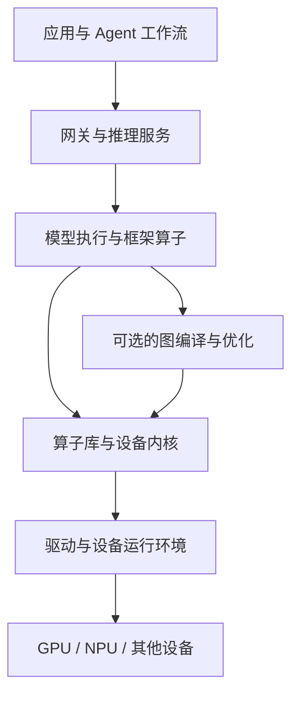

# 第 10 章 · 工程底座（含数值/编译器级调试）

> 所属：第二部分 · 核心能力  ·  [← 返回目录](../README.md)

推理服务升级后，少数任务开始出现错误数字。模型权重没换，HTTP 成功率和延迟都正常。问题可能来自输入预处理、采样配置、缓存、量化或底层实现；只看最终文本，很难知道应该回滚哪一个对象。

第 8 章让质量异常可见，第 9 章为调查和恢复建立组织约定。本章讨论下一步：如何把一个模糊的"模型变差了"，缩小成具有输入、环境和对照结果的工程问题。目标是到达证据支持的层级，而不是要求每位 SRE 都成为编译器或 kernel 工程师。

---

## 工程底座提供的是可区分解释的能力

AI 可以协助读取代码、提出假设和设计实验，并没有理由认定它无法处理底层问题。架构师仍需理解系统机制，是因为任何调查工具都可能给出错误解释；诊断必须经得起测量、对照和复现。

经典能力在这里继续起作用：排队与容量模型帮助区分负载变化和单请求变慢；性能分析帮助定位 CPU、设备计算、数据传输和同步等待；Linux、网络与存储排障用于识别资源限制、连接和数据读取问题。KV cache 通常驻留在设备内存，某些系统支持卸载；是否涉及主存或磁盘，需要依据实际实现，不能一概而论。

这些基础与数值调试也会相遇。例如，流量变化可能改变动态批次和执行形状，使特定算子路径更常出现。负载与质量同时变化时，不能只归因于模型，也不能仅凭这一相关性宣布发现了 kernel bug。

---

## 认识执行栈，但不要假定只有一条路径

下面是一张用于定位的简图。实际后端可能使用自定义执行路径、预编译库或编译生成的内核，并非每次请求都逐层经过所有组件。

编译与优化工具包括 XLA、Inductor、TensorRT 等；它们的适用平台和接入方式不同。CUDA、ROCm 是相应设备的软件平台，Triton 是编写和生成设备内核的语言与编译工具，不能把它们都当成同一种 kernel。

对 SRE 而言，第一步是记录本服务实际启用了什么：哪种 attention 实现、是否编译、是否量化、使用何种设备与并行方式。只有知道请求走过哪条路径，后续禁用某项优化或更换后端的实验才有解释力。

---

## 区分数值差异、非确定性与功能错误

浮点运算有有限精度，数学上等价的表达式，未必得到逐位一致的结果。[PyTorch 的数值精度文档](https://docs.pytorch.org/docs/main/notes/numerical_accuracy.html)说明，运算顺序、批处理方式和平台等都可能影响结果。由此要区分三个问题：

- **不同配置是否存在差异**：例如 bf16 与 fp32、批处理与单样本、编译与非编译路径之间的差异。各条路径自身仍可能稳定。
- **同一条件下是否可重复**：受控输入与环境中，多次执行仍有变化，才需要继续排查随机性、调度或非确定算子等因素。
- **差异是否违反任务或算子的要求**：输出不同不自动等于质量变差；算子数值接近，也不证明整条业务链路正确。

固定 seed、使用贪心解码可以缩小随机性来源，但不能保证跨设备、版本或执行形状逐位一致。[PyTorch 的可复现性文档](https://docs.pytorch.org/docs/main/notes/randomness.html)也明确了这些限制。确定性算法设置约束的是其支持的操作，可能增加开销或在不支持时报错；它不是消除所有差异的总开关。

在生成任务里，微小的 logits 差异可能改变一个 token 的选择，之后输入前缀也随之不同，整段文字就会分叉。这既可能不影响答案，也可能改变关键数字。调查应同时检查中间数值与任务结果，不宜用"文本必须完全相同"作唯一标准。

---

## 一条从质量异常到最小复现的路径

### 1. 先控制影响，并保存对照条件

如果已经确认业务影响，按现有恢复策略收缩流量、停止受影响优化或回到经过验证的配置，同时保留调查所需信息。恢复操作需要检查兼容性和容量，不能假定高精度或旧后端一定能承接当前负载。

保存异常样本及其授权范围内的必要证据，同时记录正常对照。只保存 prompt 常常不够：相同文本可能被不同 tokenizer、模板和配置变成不同输入。

| 记录类别 | 关键内容 |
|---|---|
| 输入与任务 | 原始样本引用、实际 token、模板、长度及预期行为 |
| 模型与生成 | 权重版本、量化配置、采样、停止与长度限制 |
| 执行环境 | 后端、框架、编译与算子库、驱动、设备和并行配置 |
| 请求形状 | batch、padding、并发、缓存和相关路由信息 |

生产数据无法原样带入实验时，应在脱敏或合成样本上重新确认现象是否仍存在；不能默认替换后仍是同一个问题。

### 2. 从便宜的解释开始排除

先核对输入是否被截断、chat template 是否变化、检索资料是否一致、停止条件是否提前触发、网关是否切换上游。再检查负载、缓存、精度和执行路径。这个顺序用于降低调查成本，不是要求在已知设备异常时仍机械地走完所有上层检查。

一次只改变能解释结果的关键条件，并重复观测。下面这些现象都只是线索：

| 观察 | 下一项可区分的验证 |
|---|---|
| 只有长输入失败 | 对照截断、位置、缓存与执行形状 |
| batch 改变后结果变化 | 核对 padding、mask、算子选择与数值容差 |
| 关闭编译后问题消失 | 固定输入与配置，继续缩小编译或融合路径 |
| 只在某设备池出现 | 对比路由、构建产物、驱动与硬件状态 |

关闭编译后改善，支持继续调查相应路径；它还不能单独区分编译器、算子实现或配置差异，更不能跳过复现直接宣布根因。

### 3. 在共同输入处比较，不追逐已经分叉的文本

先确认两条路径使用相同的 token 输入，再找到首次出现差异的输出位置。若能访问 logits，可以固定同一段 token 前缀，让两条路径计算下一步分布；否则，分叉后比较的是不同输入，差异会混入前序选择的影响。

对中间张量，可以记录最大绝对差、整体误差、非有限值，以及关键候选排序的变化。逐元素容差常可写成：

$$
|x_i-y_i|\le \text{atol}+\text{rtol}\,|y_i|
$$

其中 $y$ 是选定的参考结果。接近零时仅看相对误差容易误导，固定的绝对容差也可能掩盖小量上的重要变化。容差应依据算子、数值尺度和任务要求确定；fp32 或 CPU 路径是有用的对照，并不天然等于精确答案。

当关键结果明确随精度或执行路径变化，再缩小到具体层、算子或融合片段。比较编译与非编译路径、高精度对照、不同输入形状，可以逐步定位；是否读取 IR 或生成代码，应由已有证据和专门团队协同决定。

### 4. 缩到别人能重跑的证据包

一个有用的最小复现，应包含必要输入、环境与构建信息、运行步骤、预期依据、实际结果、发生频率和已经排除的解释。能移除应用和大模型时就移除；若问题依赖特定形状、并行或编译上下文，也要保留这些条件。

最小不等于最短。调试工具、算子融合或执行顺序变化，有时会让问题消失；此时应记录哪些改动使它不可复现，而不是把一次通过当作修复。交给后端或编译器团队的材料，应让他们能够重建区别，而非只看到一句"升级后回答变差了"。

---

## 从公开事故中学方法，也保留证据边界

Anthropic 的[2025 年事故复盘](https://www.anthropic.com/engineering/a-postmortem-of-three-recent-issues)记录了与混合精度和 XLA approximate top-k 相关的问题，表现还依赖 batch 和模型配置。团队通过调查缩小到具体实现路径，并调整采样实现。

这个案例说明，底层实现可以影响输出质量，且定位时需要控制执行条件。它不支持"后端升级后的质量变化多半来自编译器"，也不意味着所有精度差异都是事故。更可迁移的是调查方法：保留对照，识别触发条件，缩小到能够复现和交付修复的对象。

---

## 深度要与职责和升级路径匹配

通用 SRE 应能识别质量回归、冻结证据、排除常见输入与配置问题，并完成可靠的升级交接。推理平台工程师需要进一步理解缓存、批处理、精度和执行后端。涉及编译变换、内核实现或设备问题时，则应与相应专家协作。

团队可以采用不同分工，但每个故障层级都要有实际可用的负责人、复现环境和响应路径。若全部知识只在一个人脑中，即使那个人很强，系统仍存在明显的恢复风险。

训练也应以证据为目标。没有 GPU 时，可以用小矩阵展示精度和运算顺序的影响，并练习编写复现说明；它验证的是机制，不足以声称已经复现生产级 LLM 故障。不同精度结果一致也是有效观察，不必为完成练习强行找出一个差异。

本章应留下版本与环境清单、分层诊断 runbook、一次实际或明确标注范围的复现实验，以及升级和回归验证步骤。当执行后端、设备或优化策略变化时，重新验证相关假设和容差；不能把一组调试参数永久当成正确配置。

到这里，第二部分形成了一条完整路径：定义成功，约束动作，管理组合行为，取得质量证据，完成组织决策，并在必要时深入运行机制。第三部分将把它们汇成可评审的参考架构与决策产物。

---

## 接下来

- **关联练习**：[Unit 5 · 数值与编译器级调试](../练习/Unit5-数值与编译器级调试/总览.md) —— 用对照与最小复现写出可执行的 runbook
- **深入专题**：[AI 系统事故模式库](../深入/10-AI系统事故模式库.md) · [Quantization 为什么有时坏](../科学/03-Quantization为什么有时坏.md)
- **进入第三部分**：[第 11 章 · AI 系统参考架构](../架构/01-AI系统参考架构.md) —— 把能力落实到组件、契约和恢复控制

复习：[核心概念卡](../复习/核心概念卡.md) · [Active Recall 题库](../复习/Active-Recall题库.md)

---

← [第 9 章](08-组织与判断力.md)  ·  [📖 目录](../README.md)  ·  [第 11 章 →](../架构/01-AI系统参考架构.md)
