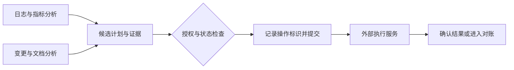

# 第 7 章 · 从链到图：多智能体系统的可靠性

> 所属：第二部分 · 核心能力  ·  [← 返回目录](../README.md)

事故助手把日志、指标、近期变更和 runbook 分给四个 Agent 分析。日志分支返回"可能与新版本有关"，汇总时却变成了"新版本导致故障"。与此同时，两个分支都尝试重启同一组实例。每个 Agent 的局部行为看起来都有理由，组合结果却不满足任务要求。

第 6 章为单个执行路径规定了权限与状态边界。当路径扩展成有并行、委派和循环的图时，仍然要使用这些控制，但还需明确交接语义、完成条件和副作用归属。链本身也是图的一种；新增的困难来自更多执行关系，而不是另一套可靠性定律。

---

## 先画控制流，再讨论有多少 Agent

同一个模型可以扮演多个角色，多个模型也可以共用一个执行服务。角色数量不能直接代表隔离程度、可靠性或组织责任。评审应先画出谁启动谁、谁等待谁、谁能提交状态，以及谁持有外部写权限。

| 协作形态 | 主要收益 | 需要验证的风险 |
|---|---|---|
| 顺序流水线 | 分阶段处理、逐段检查 | 上下文丢失、上游错误传播 |
| 编排器与 worker | 并行分析、集中合并 | 调度与合并错误、编排状态丢失 |
| 分层委派 | 分解复杂任务、控制局部上下文 | 深度失控、层间契约不一致 |
| 对等协作 | 动态交换信息与任务 | 循环等待、预算协调、状态冲突 |

集中编排通常便于集中记录任务状态和提交决策，但不要求把所有执行集中到一个进程。状态可以持久化，实例可以故障转移；反过来，使用一个编排器，也不会自动保证诊断清楚。对等协作同样可以有明确的状态协议和服务负责人。

因此，更值得问的是：哪份记录是当前任务状态的权威来源，哪些规则决定谁能更新它，以及失败后如何恢复。编排器保存的结论仍可能是错的，"状态权威"不能解释为"事实必然正确"。

---

## 并行的收益取决于合并条件

沿用第 4 章的教学假设：每个必要步骤独立、正确率为 95%，暂不计编排和合并错误。四个 worker 各执行三个必要步骤，若必须全部正确，合并成功率为：

$$
P_{\text{AND}}=(0.95^3)^4=0.95^{12}\approx54.0\%
$$

这与同样 12 步串行、同样要求全部正确的成功概率一致。理想条件下关键路径可以缩短，但调度、合并、共享资源竞争和排队仍要计入实际耗时。并行本身没有减少必须成立的条件。

若各分支是独立的候选答案，存在一个可靠选择机制，能在至少一个候选正确时选中它，那么"至少一个正确"的概率才可写成：

$$
P_{\text{at least one}}=1-\prod_{i=1}^{k}(1-p_i)
$$

它不是实际交付正确率：选择器可能挑错，也可能拒绝所有候选。对于互补的日志、指标和变更分析，缺一项往往意味着证据不完整，更不能套用这个冗余公式。

多个 Agent 共享模型、资料或错误前提时，分支正确性还会相关。让四个 Agent 依据同一份过期 runbook 投票，并不等于四份独立证据。相关性本身不决定联合成功率一定升高还是降低；它使只凭各分支边际分数的计算不再充分。应在同一批任务上验证合并规则，以及它面对相互矛盾、缺失和错误结果时的表现。

---

## 交接契约要保留结论的证据身份

开头的"可能相关"变成"确定根因"，是一次交接失败。格式正确并没有阻止语义升级。比起把一大段摘要交给下游，更可检查的交接对象应包含：

| 内容 | 需要保留的区别 |
|---|---|
| 任务范围 | 哪个任务、租户、服务和时间段 |
| 观察与来源 | 实际看到什么，原始证据在哪里、何时取得 |
| 结论状态 | 已观察、推测、已验证或仍有争议 |
| 缺口与限制 | 缺哪些数据，哪些解释尚未排除 |
| 执行状态 | 尚未执行、已提交、已确认或结果未知 |

接收方先做结构、身份和版本检查；在影响关键判断的交接点，再核验来源与适用性。昂贵的语义 verifier 应按风险和实测收益放置，不必机械地给每条内部边都调用一个 judge。第 4 章关于漏检、误拒和成本的限制，仍然适用。

另一个常见问题是权限借用：读外部资料的 worker 没有生产权限，却把恶意要求包装成建议，交给有写权限的主 Agent。主 Agent 必须按当前用户授权和资源范围重新判定；子 Agent 的请求不能自动成为新的授权。只分开上下文，没有分开凭证和执行检查，隔离就没有完整建立。

---

## 重试与恢复必须认识外部副作用

假设重启请求已经发到执行服务，但响应丢失。worker 看到超时后再次发起，编排器恢复时又重放一次。如果每次都产生新的操作，这个任务可能多次重启同一资源。顺序链也会出现这种问题，并行与恢复只是增加了重放机会。

一个可用的设计，是把分析与提交分开：worker 返回证据或候选计划，受控提交服务检查计划并执行写操作。提交服务需要为同一业务意图使用稳定的操作标识，记录请求参数与状态，拒绝同一标识下不一致的请求，并让重复请求查询或返回既有结果。[AWS 关于幂等 API 的实践](https://aws.amazon.com/builders-library/making-retries-safe-with-idempotent-APIs/)说明了这类调用方标识及原子记录的重要性。

但幂等键只解决相应范围内的重复执行。两个不同意图仍可能争抢同一资源，还需要资源版本检查、互斥或业务状态机。若本地操作记录与外部写入不能原子提交，应显式保存"结果未知"，通过下游幂等接口或对账确认；不能用本地记录宣称跨系统已经恰好执行一次。

检查点也应保存任务状态、操作标识、已确认结果和未完成工作。恢复后先确认外部动作状态，再决定是否重做。取消任务可以停止后续调度，却不能自动撤销已经发生的写入；必要时需要补偿与人工接管。

---

## 给整张图一份可执行预算

只给每个 Agent 限轮数，仍可能挡不住递归扇出。若每个节点都启动 $k$ 个子任务，最多委派 $d$ 层，完整展开的节点数是：

$$
N=1+k+\cdots+k^d=\frac{k^{d+1}-1}{k-1},\qquad k>1
$$

例如 $k=3,d=4$ 时有 121 个节点。这只是全部展开的调用结构上限示例，不代表真实 token 成本必然按此增长；每个节点的工作量、共享上下文和缓存策略还会改变账单。

因此，任务级预算应同时限制总调用量、并发、委派深度、扇出、截止时间和外部操作次数。预算应由可信的统一服务或可协调的配额机制执行，不能让每个子任务都误以为自己拥有全额预算。

等待关系也要有退出条件：分支超时后，是交付注明缺口的部分结果、切换另一条路径，还是整项任务失败？合并处应知道它等待的是全部结果、任一合格结果，还是达到某个证据条件。循环不是天然错误，有明确进展判据和预算的纠错循环可能很有用；无界等待与重复委派才需要被截断。

网络接缝也应按真实通信边数统计。只有允许所有 Agent 两两通信时，潜在无向配对才是 $m(m-1)/2$；稀疏图无需承担完整连接的接缝数量。少开不必要的边，既减少信息污染，也减少权限检查和排障范围。

---

## 图级 trace 要能支持恢复和归因

单个模型调用的日志无法解释组合行为。至少需要关联任务标识、父子或委派关系、分支与尝试次数、输入和证据版本、合并决定，以及外部操作标识。异步汇合可能有多个前因，不能只靠时间先后猜测因果关系。

通过这些记录，应能还原：哪项观察最早缺少证据，哪里把假设当成事实，哪个分支触发了动作，以及重试为何发生。对于语义失败，trace 仍需与第 8 章的评估结果关联，记录本身不会自动判断真伪。

验收时至少演练四种情况：一个分支返回错误证据、一个分支永不返回、一次写操作响应丢失、编排实例在提交后重启。检查系统是否按约定停止、合并、恢复或对账，同时核对预算是否仍然有效。

图越复杂，越需要明确的端到端服务负责人及其决策权限。负责人可以跨团队协调，不必亲自实现每个节点；拓扑也不能替代责任划分。若在同一任务集上，多 Agent 没有带来足够的质量、时延或隔离收益，就应重新考虑分工和通信边，甚至退回更简单的工作流。

本章应留下执行拓扑、交接契约、写入与恢复协议、全局预算，以及能够还原因果关系的 trace。下一章将把这些执行记录转成可复核的质量证据。

---

## 接下来

- **下一章**：[第 8 章 · 质量可观测性与 Data Flywheel](07-质量可观测性与DataFlywheel.md) —— 从执行证据建立评估与改进闭环
- **关联架构**：[第 11 章 · AI 系统参考架构](../架构/01-AI系统参考架构.md) —— 把编排、执行、质量与运维控制接起来
- **深入专题**：[AI 系统事故模式库](../深入/10-AI系统事故模式库.md) · [LLM 网关的 SRE 视角](../深入/17-LLM网关的SRE视角.md)

复习：[核心概念卡](../复习/核心概念卡.md) · [Active Recall 题库](../复习/Active-Recall题库.md)

---

← [第 6 章](06-AI自治与上下文架构约束.md)  ·  [📖 目录](../README.md)  ·  [第 8 章 →](07-质量可观测性与DataFlywheel.md)
