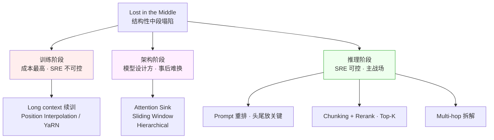

# 科学 02 · "Lost in the Middle" 为什么会发生

> [← 返回目录](../README.md)  ·  前置：[科学 01 · Attention 与 Transformer 的 SRE 视角](01-Attention与Transformer的SRE视角.md)  ·  相关：[深入 03 · 最佳实践](../深入/03-模型与工具场景化最佳实践.md)

> [!NOTE]
> **核心问题**：为什么长 context 里"中间的信息"最容易被模型忽略？这是在部分模型和任务上观察到的位置偏差，幅度随模型、训练与任务而变。理解可能机制，有助于设计工程验证。

---

## 0. 现象：中间塌陷与"有效长度"幻觉

Liu et al. 2023 的论文《Lost in the Middle》给了 LLM 社区第一个震撼结果：

- 在长文档里埋一条关键信息
- 问模型关于这条信息的问题
- **关键信息在开头或结尾时**，准确率 80%+
- **关键信息在中间时**，准确率跌到 50% 甚至 20%

后续 RULER 基准（NVIDIA 2024）系统性地评测了各家模型的"有效长度"——在其受测样本中，宣称 ≥32K 的模型只有部分能稳定用到 32K。具体的"宣称 vs 实测有效"历史快照表见 [深入 03](../深入/03-模型与工具场景化最佳实践.md)，不能直接代表当前所有模型。

注意这是两个测不同东西的基准，别混为一谈：

- **Liu et al. 2023 测位置敏感度**：同一条信息放在 context 的不同位置，准确率曲线呈 U 型——首尾好、中间差
- **RULER 测长度退化**：context 拉长后质量何时开始下滑，结论是"有效长度远小于宣称值"——它不产出 U 型位置曲线

**"有效 context" ≠ "宣称 context"**，而且中间位置最容易被忽略。两个现象叠在一起，才是长 context 的真实可用面貌。

> [!NOTE]
> **后续模型与基准快照：** Liu et al. 的 U 型曲线来自 2023 年模型与特定任务设置。此后一些模型在特定单针检索基准上取得很高分，但结果不能外推到所有模型、输入位置或真实任务；长上下文中的多事实检索、推理与干扰鲁棒性仍需分别评测：
>
> - **多针 / 聚合推理仍需单独验证**：公开 MRCR 等基准显示，多条分散事实的检索与综合表现会随模型、任务和上下文长度变化；不同基准的分数不可直接横向比较。
> - **长输入可能带来质量退化**：Chroma 2025 的一项 18 模型研究观察到被测模型随输入变长出现退化；这是该研究样本和任务的结果，不代表所有模型与所有任务都以相同方式退化。
>
> **单针 needle test 通过 ≠ 长 context 可靠**（§4.2 会再强调）。下面讨论的是可能相关的机制；不能仅凭基准表现就断言某个机制在具体模型上已被证实。

---

## 1. 可能机制：四类相关因素

### 1.1 训练分布的"首尾偏好"

训练语料中可能存在**首尾信息更突出的结构**，例如：

- 新闻稿：重要事实在标题和首段
- 代码：函数签名和 return 在头尾
- 对话：问题在开头，答案在末尾
- 小说：开场交代 + 结局揭示

**可能影响**：模型可能学到首尾偏好。但这只是机制假说，不能据此断言所有模型的中间信息都训练不足。

### 1.2 位置编码的几何偏差

Transformer 不能天然理解位置顺序——需要"位置编码"告诉它 token 的相对位置。

主流方案：

**RoPE（Rotary Position Embedding）** — 当前最流行
- 通过旋转向量表示位置
- 用相对位置相关的旋转影响 Q/K 点积，不意味着向量距离随 token 距离单调增加
- **风险**：未经适配就超出训练长度时，位置外推可能失效

**ALiBi（Attention with Linear Biases）**
- 给 attention 分数加一个线性衰减项
- 越远的位置分数越低
- **副作用**：天生的"偏向近处"

**工程含义**：位置编码可能影响远距离依赖，但不能单靠这一项推导出所有模型都呈 U 型位置曲线。

### 1.3 Softmax 的"稀释效应"

回忆 [科学 01](01-Attention与Transformer的SRE视角.md) 的公式：

```
attention = softmax(Q·K^T) · V
```

Softmax 把 N 个 score 归一成概率分布。增加候选位置会增加竞争，但各位置分到多少权重，取决于 score 的相对差值。对一个 head 的单个 query，所有可见位置的权重平均值为 `1/N`：

- Context 1k：每个位置平均 attention = 1/1000
- Context 128k：每个位置平均 attention = 1/128000
- Context 1M：**每个位置平均 attention ≈ 1/1000000**

**平均值不能代表关键位置的权重**：即使 N 很大，只要某个位置的 score 显著更高，它仍可能获得较大权重。因此 `1/N` 不能单独解释中间塌陷。

> [!WARNING]
> 这是模型训练分布、位置编码、注意力竞争和上下文干扰共同造成的现象，不是单靠一个 prompt 技巧就能消除的 bug。Softmax 只是归一化步骤；实际注意力分布并不均匀，不能用 `1/N` 当作每个位置的真实权重。工程上应通过检索、重排、分块和任务专属 eval 来降低风险。

### 1.4 Attention Sink 现象

部分模型的实测发现：**前几个 token（甚至是无意义的 BOS token）**在某些 attention head 中能拿到异常高的注意力。

原因（猜测）：softmax 必须总和为 1，模型需要一个"出口"把多余的 attention 倾倒出去——前几个 token 成了默认"垃圾桶"。

**需要区分**：attention sink 的高权重不等于开头的语义信息一定被正确使用；recency bias、位置编码和任务分布也可能参与位置偏差。它们与 Lost in the Middle 有关联，但不能据此认定某一个就是所有模型的直接成因。

---

## 2. 工业界的应对方案

针对这个结构性问题，工业界在三个阶段各有方案——只有推理阶段是 SRE 可控的主战场：



### 2.1 训练阶段

**Long Context 训练**
- Llama 3.1 在 128k 长度的数据上继续训练
- 训练样本刻意在中间放关键信息
- **但成本高、数据难收**

**Position Interpolation + YaRN**
- 微调让 RoPE 外推到更长
- Qwen 公开使用 YaRN；闭源厂商的做法未公开，但业界普遍采用同类位置外推技术
- **副作用**：推理时要保持和训练一致

### 2.2 架构阶段

**Attention Sink（StreamingLLM）**
- 显式保留前 4 个 token 永不驱逐
- 对长 streaming 场景有效
- 但不解决"中间被忽略"

**Sliding Window**
- 每个位置只看最近 W 个
- 中间的"窗口范围外"彻底丢
- Mistral 用这方案

**Hierarchical / Summary Layers**
- 先压缩中间内容再 attention
- 新研究方向，尚未主流

### 2.3 推理阶段（SRE 能控制的）

- **Prompt 重排**：把关键信息放头尾
- **Chunking + Rerank**：先检索 → rerank → 只喂 Top-K 最相关
- **Multi-hop**：拆成多个小 context 分别处理再汇总
- **Confirmation**：让模型明确引用位置，没引用就重问

---

## 3. SRE 角度的工程含义

### 3.1 "长 context 替代 RAG" 的迷思

2024 年 Gemini 1.5 Pro 发布后，有种声音："1M context 让 RAG 过时了。"

**这是错的**。

- 长 context 质量**可能随长度和位置退化**
- 长 context 输入计费通常随 token 数增长，实际计算成本还受 attention 架构与缓存影响
- 长 context **可能增加延迟**，幅度取决于 prefill、缓存、模型和硬件
- RAG 的 chunking + rerank 本质上是**把"本该由模型注意力来做的筛选"前置到搜索引擎**

**正确立场**：长 context 是工具箱里的一把工具，不是替代 RAG 的银弹。

### 3.2 Prompt 架构的经验规则

基于机制，设计 prompt 的规则：

```
[最前] System prompt                 ← attention sink + 重要指令
[前段] 工具定义 / CLAUDE.md           ← attention 强
[中段] 检索出的文档片段（可能被稀释） ← rerank 后只放 Top-K
[末段] 历史对话
[最末] 当前用户请求 ★                ← recency bias 加持
```

> [!TIP]
> **把"最想让模型记住的指令"复述两次**——一次放系统提示开头，一次放用户消息末尾。利用头尾双重 attention 加持。

### 3.3 RAG 里 Rerank 的地位

给工程上的直观解释：

- 你从 100 条片段里选 20 条喂进 context → "中间塌陷"风险极大
- **Rerank 之后只放 Top-5** → 减少干扰和上下文长度，但不保证每条都在首尾，也不保证相关事实没有漏掉

**结论**：Rerank 是减少检索噪声的常用工具；是否必要，要看召回质量、延迟预算和任务 eval，不能由 long context 的局限直接推出。

### 3.4 多跳推理的代价

多跳推理（跨多个段落检索并综合信息）与单跳检索测量的能力不同。报告结果时应控制模型、任务、上下文长度、位置和计分方式；不能把不同基准上的单针与多针分数直接作定量比较。

**SRE 工程做法**：

- 把多跳拆成多个单跳
- 每步用独立 API call
- 中间结果可审计

---

## 4. 观测与监控

### 4.1 "有效 context 曲线"

对你的实际 workload，建一个监控曲线：

```
质量 ↑
   │ ●●●●●●●
   │        ●●●●
   │             ●●●
   │                ●●●●●●●
   └─────────────────────────→ context 长度
    0k  10k  50k  100k  500k
```

找到你场景下的**"曲线开始下降的拐点"**——超过这点就该换方案（RAG / 多跳 / 拆分）。

### 4.2 Needle Test 不够

**单针 needle test（"第 X 行是什么"）**只测有限的检索能力。某些模型在特定配置上得分很高，但不能据此推断所有位置、干扰条件或真实任务都能答对。

**实测要用**：

- Multi-needle test（多个事实要同时找到）
- Reasoning test（找到事实 + 推理）
- Distractor test（有相似但错误的信息干扰——长文里干扰项危害被放大，见 §0 context rot）

### 4.3 生产中的异常信号

- 用户问"这份文档里 X 是什么？"，模型引用了错的段落 → 中间位置被忽略
- 用户抱怨"你前面才说过的你忘了" → 历史对话中段被稀释
- 长链 Agent 的决策引用了旧信息 → 注意力没到该到的地方

---

## 5. SRE 实操清单

- [ ] 不要信厂商的"宣称 context"数字。用 RULER 或你自己的 multi-needle 测
- [ ] Prompt 架构遵循"首尾放关键内容"规则
- [ ] RAG 系统评估是否需要 rerank；只用 embedding 相似度时，用任务样本验证召回和噪声是否足够
- [ ] 复杂任务拆成多跳小 context，不是堆到一个大 context
- [ ] 关键指令头尾各说一遍
- [ ] 建立"context 长度 → 准确率"曲线，找到你的"拐点"
- [ ] 监控：当生产 context 长度超过拐点的比例增加时告警

---

## 6. 常见误区

- ❌ **"1M context 可以装下全部业务数据直接问"** — 越长越不可靠（context rot），多跳更会塌陷
- ❌ **"Rerank 一定可以省或一定不能省"** — 用检索质量、延迟和任务 eval 决定
- ❌ **"Needle test 通过就等于真实场景能用"** — 多针 / 多跳才是真考验
- ❌ **"关键信息放中间没关系，反正模型应该都能看到"** — 可见不等于可靠使用，位置敏感度需要实测
- ❌ **"长 context 模型一定优于短 context"** — 对短任务反而可能更差（训练分布偏移）

---

## 7. 给 SRE 的一句话总结

> [!IMPORTANT]
> **Lost in the Middle 是需要按模型和任务验证的位置偏差**；注意力竞争、位置编码、训练分布等都是可能因素，不能只靠 softmax 归一化证明其必然发生。
>
> 工程上通过检索、重排、prompt 布局和任务拆分减少风险，并用位置 × 长度 × 干扰强度的 eval 验证效果。

---

## 8. 参考资料

- Liu et al · 《Lost in the Middle: How Language Models Use Long Contexts》(2023) — https://arxiv.org/abs/2307.03172
- NVIDIA · 《RULER: What's the Real Context Size of Your Long-Context Language Models?》— https://github.com/NVIDIA/RULER
- Chroma Research (Kelly Hong) · 《Context Rot: How Increasing Input Tokens Impacts LLM Performance》(2025) — https://www.trychroma.com/research/context-rot
- Xiao et al · 《Efficient Streaming LLMs with Attention Sinks》— https://arxiv.org/abs/2309.17453
- Peng et al · 《YaRN: Efficient Context Window Extension》— https://arxiv.org/abs/2309.00071
- Press et al · 《Train Short, Test Long (ALiBi)》— https://arxiv.org/abs/2108.12409
- Anthropic · [Context Engineering 博客](https://www.anthropic.com/engineering/effective-context-engineering-for-ai-agents)（对应 "attention budget" 概念）

🔄 复习：[核心概念卡](../复习/核心概念卡.md) · [Active Recall 题库](../复习/Active-Recall题库.md)

---

← [科学 01 · Attention 与 Transformer 的 SRE 视角](01-Attention与Transformer的SRE视角.md)  ·  [📖 目录](../README.md)  ·  [科学 03 · Quantization 为什么有时坏 →](03-Quantization为什么有时坏.md)
